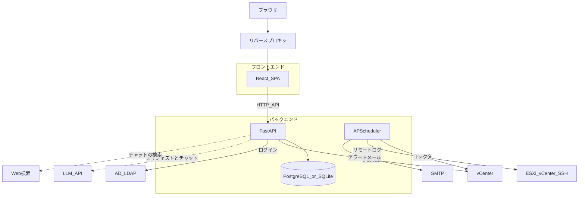

# vCenter Event Assistant

vCenter のイベントとホストメトリクス（CPU/メモリ利用率、ディスク・ネットワーク、データストア容量など）を収集し、Web ダッシュボードで一覧・傾向を確認するツールである。**アラートのメール通知**、期間を指定した **ダイジェストレポート**の生成、環境設定に応じた **LLM による要約やチャット** にも対応する。

## 主なユースケース

- vCenter の **イベント**を蓄積し、時系列で一覧・フィルタし、ルールに基づく **注目度（スコア）** で優先度付けして確認できる。
- ESXi ホストの **CPU/メモリ利用率**（`quickStats`）、**ディスク・ネットワーク**（PerformanceManager）、**データストア容量**を定期サンプルし、**推移・ダッシュボード**で傾向を確認できる。
- **複数 vCenter** を登録し、手動またはスケジュールされた **収集ジョブ**でデータを取り込める。
- バージョン付きの **コレクタプラグインAPI** により、イベントやメトリクスの収集項目を外部 Python パッケージとして追加できる。同梱のプラグインで **ESXi / vCenter のリモートログ**を SSH 経由で差分収集できる。
- 障害などの発生時、イベント（発生件数）と ESXi ホストの負荷情報の推移を 1 つのグラフに視覚化できる。**タイムライン**で期間内のイベント・メトリクス・高スコアイベントをまとめて追える。
- **アラートルール**でメトリクス閾値やイベントスコアを評価し、発火・回復を **通知履歴**に残し、SMTP 設定時は **メール通知**できる。
- 期間を指定して、イベントと ESXi ホストの負荷情報のダイジェストを生成できる。環境設定により **LLM で要約・整形**できる。
- 期間を指定して、イベントと ESXi ホストの負荷情報を LLM にコンテキストとして与え、**チャット形式で質問**できる（ベータ）。

フロントエンドの画面例などは [docs/development/frontend.md](docs/development/frontend.md) を参照する。

## アーキテクチャ

- **バックエンド**: **FastAPI** が `/api`・永続化・認証・**pyVmomi** による vCenter 収集・コレクタプラグイン・**APScheduler** などを担う。DB は `DATABASE_URL` で **PostgreSQL** または **SQLite** を選択する。
- **フロントエンド**: **React**（SPA）がダッシュボード等の UI を提供し、バックエンドの `/api` を呼び出す。開発時は Vite が `/api` をプロキシする。

リバースプロキシ・AD/LDAP・SSH（リモートログ）・SMTP・LLM・Web 検索は任意である。DB は PostgreSQL または SQLite。**データフローやバックエンド／フロントの詳細**は [docs/features/architecture.md](docs/features/architecture.md) を参照する。

## 特長

- **オープンソース**（[Apache License 2.0](LICENSE)）であり、セルフ**ホスト**での動作が可能である。
- DB は **PostgreSQL / SQLite** を `DATABASE_URL` で選択できる。
- 実績の多いオープンソースエコシステムを採用（収集は **pyVmomi** 、バックエンドは **FastAPI**、フロントは **React** ）
- **ログインとロール**（admin / operator / viewer）を内蔵し、**AD / LDAP** でのログインにも対応する。
- **アラートルール**と通知履歴、SMTP によるメール配送（評価と配送の分離・再送）を備える。
- **コレクタプラグイン**で収集を拡張できる（画面からのインストール・設定、同梱のリモートログ収集）。
- 収集間隔・データ保持日数・ダイジェストのスケジュールなどを **環境変数で調整**できる（[.env.example](.env.example) 参照）。
- イベントの種別に応じて、一般的な意味・原因・対処要否・対処方法のガイドを設定できる（主要イベント 400 超について、イベント種別ガイドを同梱）。
- イベントの種別ごとに、スコアをカスタマイズでき、環境に応じた重要度の高いイベントを見落とさないための仕組みを提供する。

## 制約、その他

- **ログインとロール（admin / operator / viewer）による権限制御を内蔵する**（[ログインとロール](docs/userguide/authentication.md)）。TLS は持たないので、本番ではリバースプロキシ等で TLS 終端とネットワーク制限を行うこと。
- **Broadcom / VMware の公式製品ではない**（[商標および免責](#商標および免責)）。
- ホスト指標は運用監視向けの限定的な項目であり、**vCenter の全パフォーマンスカウンタ網羅**や **VM 単位の詳細キャパシティプランニング専用ツール**ではない。
- **フル SIEM やコンプライアンス監査の唯一の証跡ソース**としての置き換えは想定しない（保持・改ざん耐性・長期アーカイブは運用設計が別途必要である）。
- **LLM 利用時（ベータ）**は外部 API への送信・コスト・レイテンシ・プロンプトに載るデータ範囲に注意すること。ベータ機能のため、本番の唯一の根拠資料にしない運用を推奨する。

## 商標および免責

本プロジェクトは Broadcom Inc. およびその関連会社の公式製品・サービスではない。VMware、vCenter などの名称は各社の商標であり、本プロジェクトはそれらの権利者と提携・承認・後援関係にない。

## ドキュメント

- **変更履歴**（リリースごとの変更と更新するときの注意）: [CHANGELOG.md](CHANGELOG.md)
- **ドキュメント索引**（読者別の一覧）: [docs/README.md](docs/README.md)
- **システム利用開始ガイド**（前提・セットアップ・起動方法）: [docs/operations/getting-started.md](docs/operations/getting-started.md)
- **ログインとロール**: [docs/userguide/authentication.md](docs/userguide/authentication.md)
- **AD / LDAP でのログイン**: [docs/userguide/directory-auth.md](docs/userguide/directory-auth.md)
- **アラート**: [docs/userguide/alerts.md](docs/userguide/alerts.md)
- **プラグイン（画面）**: [docs/userguide/plugins.md](docs/userguide/plugins.md)
- **リモートログ収集**: [docs/userguide/remote-log-collector.md](docs/userguide/remote-log-collector.md)
- **利用者向けガイド一式**: [docs/userguide/](docs/userguide/)
- **開発者向け手順**: [docs/development/development.md](docs/development/development.md)
- **アーキテクチャ**: [docs/features/architecture.md](docs/features/architecture.md)

## ライセンス

本リポジトリは [Apache License 2.0](LICENSE) の下で提供される。著作権表示は [NOTICE](NOTICE) を参照する。
