# vCenter Event Assistant（フロントエンド）

[vCenter Event Assistant](../../README.md) の Web UI です。React・TypeScript・[Vite](https://vite.dev/) で実装し、バックエンドの FastAPI と同一オリジンまたは開発時プロキシ経由で API を呼び出します。イベントの一覧・概要、ホストメトリクスのグラフ、保存済みダイジェスト（Markdown）の参照、vCenter 登録やスコアルールなどの設定をブラウザから行えます。

各タブの **簡易ヘルプ**（「使い方を表示」）は `frontend/src/help/tabHelpContent.ts` で要約と利用者向けガイド（`docs/userguide/*.md` 等）への対応を一元管理する。ガイド側には `<!-- vea-tab-help: ... -->` マーカーを付与し、`frontend/src/help/tabHelpContent.test.ts` でファイル存在とマーカー整合を検証する。

## 画面の例

### ログイン

認証が有効なときのログイン画面です。利用者向けの操作説明は [authentication.md](../userguide/authentication.md) を参照してください。

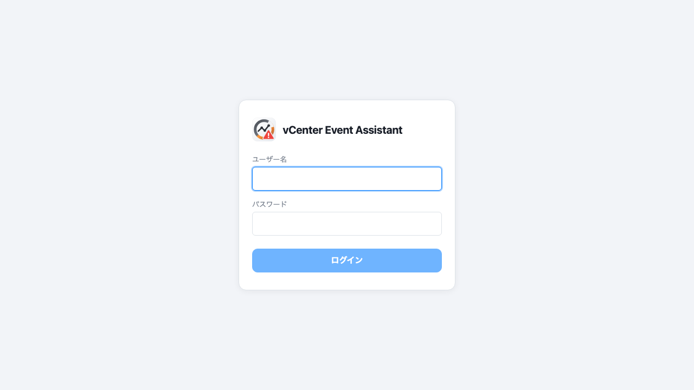

### 概要

登録 vCenter 数や直近のイベント件数、スコアの高い要注意イベントの俯瞰を表示します。利用者向けの操作説明は [summary.md](../userguide/summary.md) を参照してください。

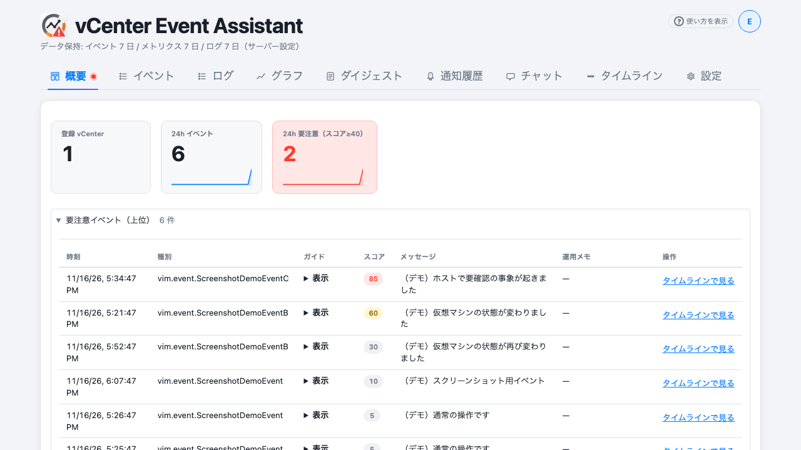

### イベント

収集した vCenter イベントを期間・キーワードなどで絞り込み、一覧表示や CSV 出力ができます。利用者向けの操作説明は [events.md](../userguide/events.md) を参照してください。

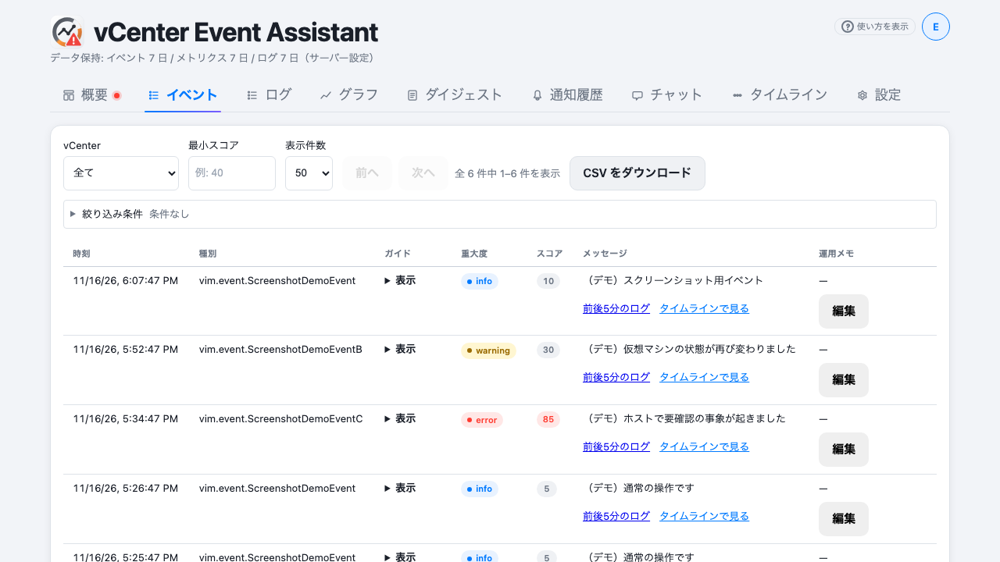

種別ごとの説明（イベント種別ガイド）は、ガイド列の「表示」を開いて参照できます。下図は展開した例です。

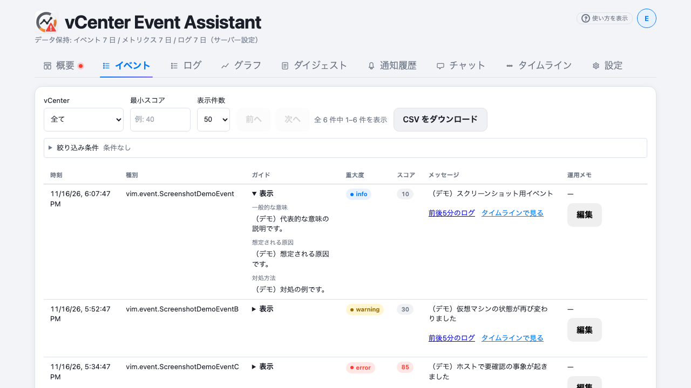

### ログ

リモートログ収集の検索画面です。接続先・種別・重大度などで絞り込み、CSV 出力もできます。

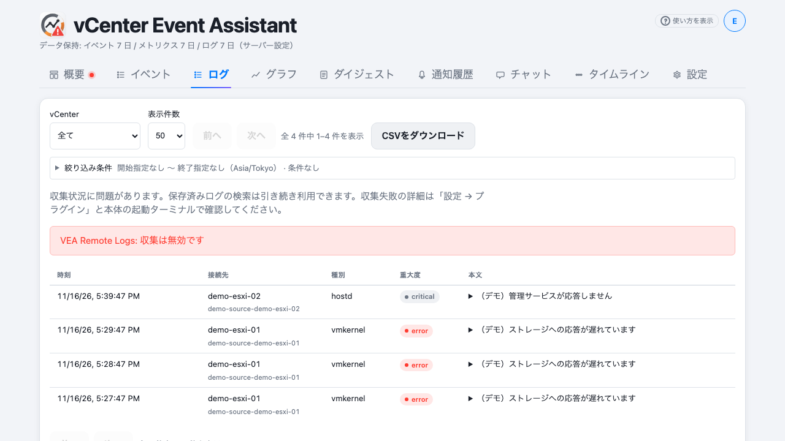

### グラフ（メトリクス）

ホストの CPU・メモリなどの時系列を、vCenter とメトリクス種別を選んで表示します。利用者向けの操作説明は [graph.md](../userguide/graph.md) を参照してください。

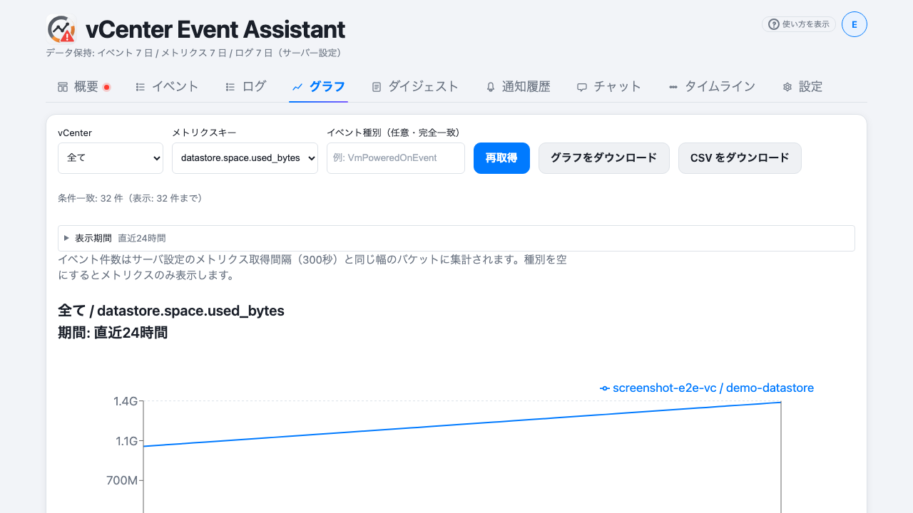

### ダイジェスト

サーバーが生成した日次などのダイジェストを一覧し、本文（表・LLM 要約を含む Markdown）を表示します。LLM 要約が記録されていない場合は `## LLM 要約` ブロックは表示しません。利用者向けの操作説明は [digests.md](../userguide/digests.md) を参照してください。

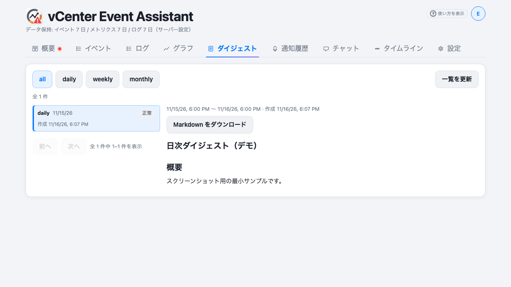

### 通知履歴

アラートルールの発火・回復の履歴を一覧します。利用者向けの操作説明は [alerts.md](../userguide/alerts.md) を参照してください。

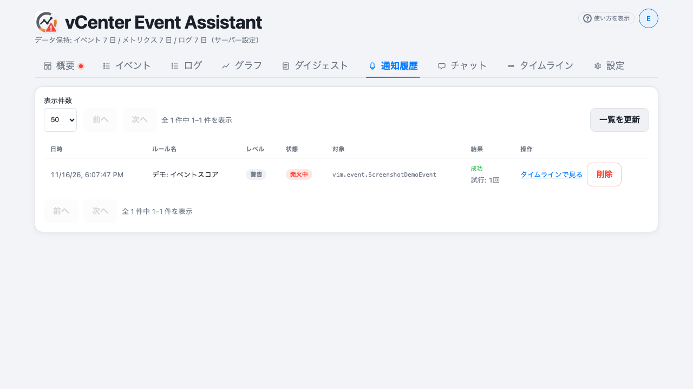

### チャット

収集済みのイベントやホストメトリクスをコンテキストとして、LLM に質問できます。
利用者向けの操作説明は **[chat.md](../userguide/chat.md)** を参照してください。概要・活用例の補助は [features/chat.md](../features/chat.md) です。

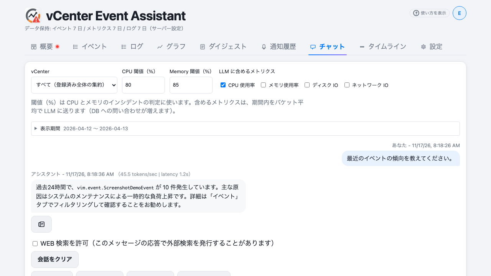

### タイムライン

障害の初動で、期間内のイベント・通知履歴（アラート）・メトリクスの超過・エラーログを時系列で並べる画面です。開くと直近 1 時間を読み込みます。利用者向けの操作説明は [timeline.md](../userguide/timeline.md) を参照してください。

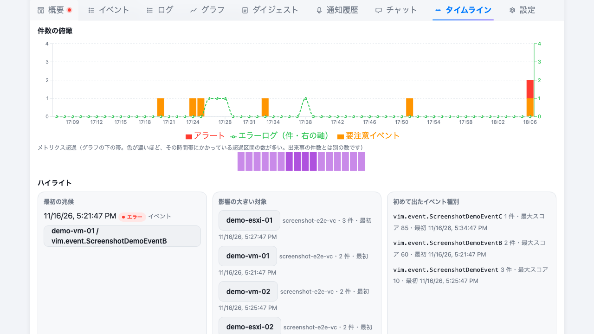

### 設定（一般）

テーマ（ライト / ダーク / システム）や、日時表示に使うタイムゾーンをブラウザに保存します。

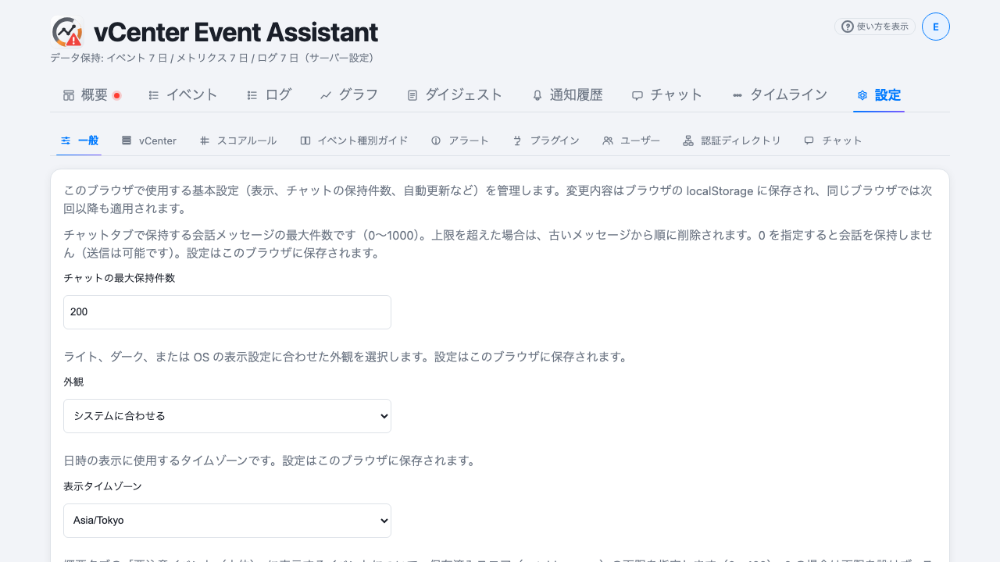

### 設定（イベント種別ガイド）

イベント種別ごとの意味・想定原因・対処を登録・編集し、JSON のエクスポート／インポートも行えます。

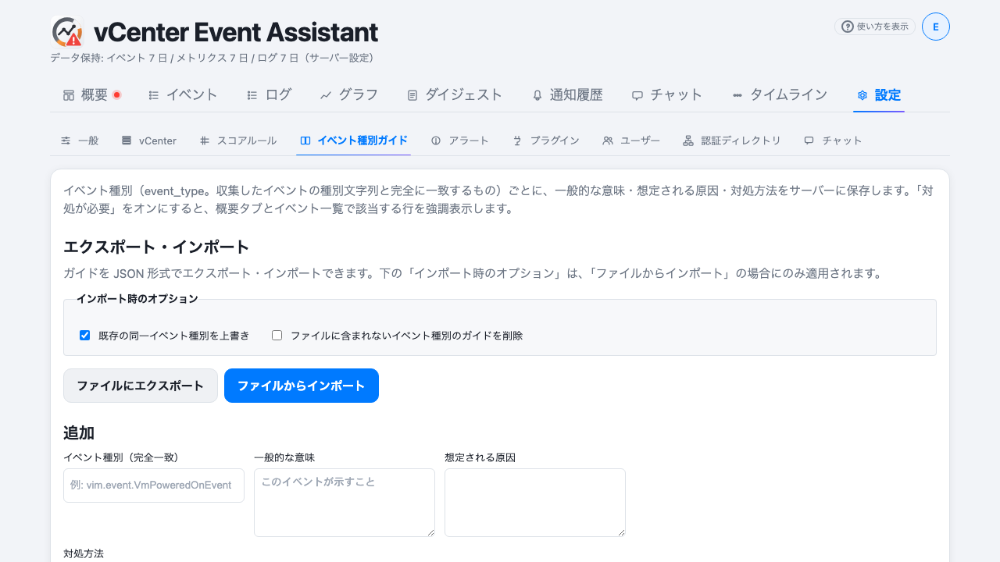

### 設定（vCenter）

vCenter の接続情報を登録・編集・管理します。

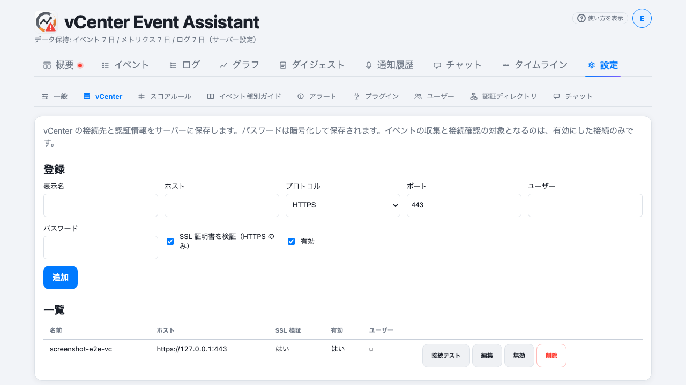

### 設定（スコアルール）

イベント種別ごとのスコア加算値を設定します。利用者向けの操作説明は [score-rules.md](../userguide/score-rules.md) を参照してください。

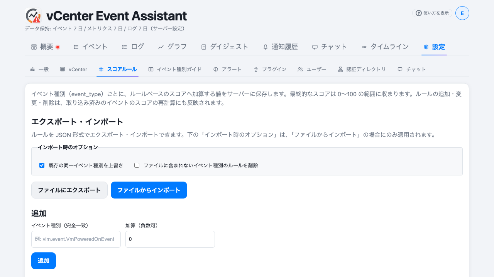

### 設定（アラート）

イベントスコア型・メトリクス閾値型のアラートルールを管理します。利用者向けの操作説明は [alerts.md](../userguide/alerts.md) を参照してください。

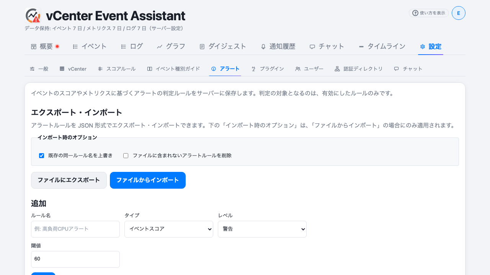

### 設定（プラグイン）

コレクタプラグインの構成と実行状態を確認します。利用者向けの操作説明は [plugins.md](../userguide/plugins.md) を参照してください。

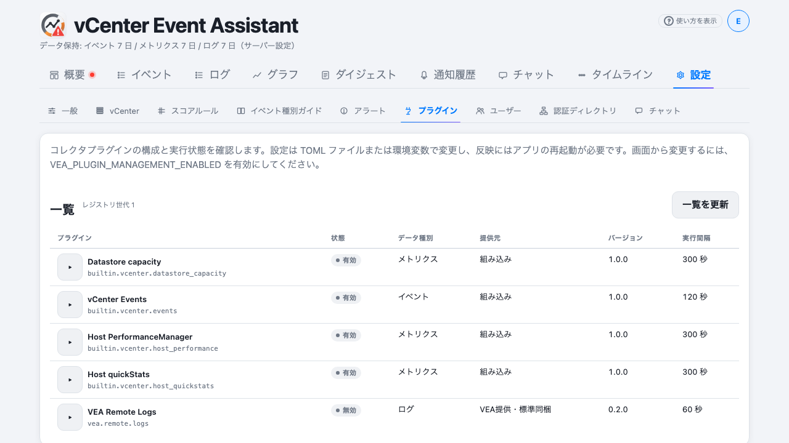

### 設定（チャット）

チャットパネルの下部に表示する、よく使う質問のスニペット（サンプルプロンプト）を設定・編集できます。

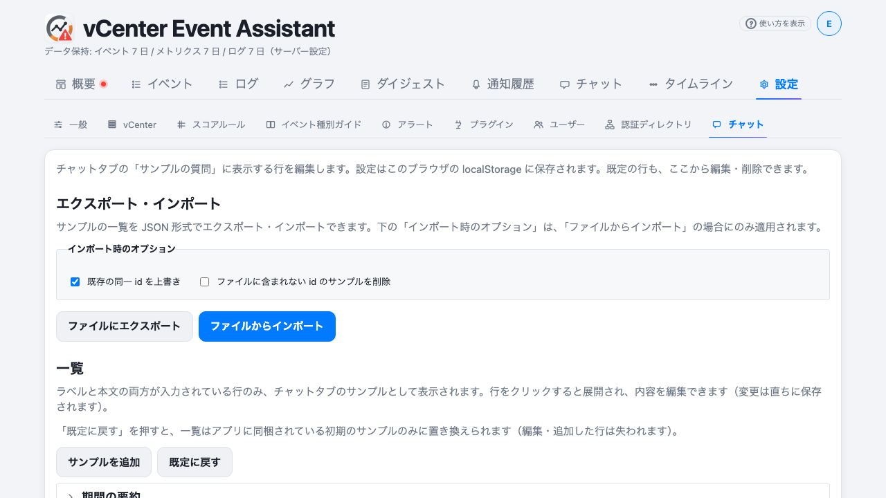

### その他の画面・キャプチャの更新

全タブの一覧と PNG の再取得手順は **[開発者向けメモ（`docs/development/development.md`）](development.md)** とプロジェクト Skill **[capture-ui-screenshots](../../skills/capture-ui-screenshots/SKILL.md)** を参照してください。リポジトリルートで次を実行すると `docs/images/*.png` を更新できます。

```bash
# 既定: 起動済みの http://127.0.0.1:8000 に接続（フロントを更新したら build してサーバー再起動）
uv run scripts/capture_ui_screenshots.py
uv run scripts/capture_ui_screenshots.py --build
# メモリ DB ＋シード付きで Playwright が API を起動するとき（CI 等・ドキュメント再取得の推奨）
uv run scripts/capture_ui_screenshots.py --spawn-server
```

## 開発コマンド

`frontend` ディレクトリで実行します。


| コマンド                  | 説明                                       |
| --------------------- | ---------------------------------------- |
| `npm install`         | 依存関係のインストール                              |
| `npm run dev`         | 開発サーバー（HMR）                              |
| `npm run build`       | 本番用ビルド（`dist/`）                          |
| `npm run test`        | Vitest 単体テスト                             |
| `npm run lint`        | ESLint                                   |
| `npm run e2e`         | ビルド後に Playwright E2E（**テスト専用** API を Playwright が新規起動。既定ポート `9323`。`screenshots.spec.ts` は除外） |
| `npm run screenshots` | ドキュメント用スクリーンショットのみ取得（既定で `localhost:8000` の起動済み API 向け） |
| `npm run screenshots:spawn` | `npm run build` のうえ Playwright が API を起動して取得（シード付きメモリ DB） |

**E2E とドキュメント用キャプチャ:** `npm run e2e` は **手元の 8000 ではなく**、既定どおりテスト用インスタンス（別ポート）で検証する。ドキュメント用 PNG は **あらかじめ 8000 で API＋フロントを起動したうえで** `npm run screenshots` またはリポジトリルートの `uv run scripts/capture_ui_screenshots.py` を使う前提である。設定の詳細は [開発者向けメモ（`docs/development/development.md`）](development.md) を参照する。

バックエンドの起動・環境変数は [リポジトリルートの README](../../README.md) を参照してください。

## 実装とレビューで確かめること

案 9 の PR #391（診断の設定）と PR #392（インシデントからの実行）のレビューで、繰り返し指摘された点をまとめる。実装の依頼とレビューの依頼では、この節を指す。

### 取り消せない操作（送ったら戻せない要求）

診断の実行のように、一度送ると取り消せない要求を出す画面では、次を確かめる。

- 送った要求の状態を、タブや履歴の移動、Esc（二度押しを含む）、ダイアログを閉じて開き直す操作で失わない。表示を外しても、応答の待ちと結果の読み直しは続ける。
- 同じ要求を二度送らない。送信中の再送を止める。応答が不確かなとき（通信の切断、時間切れ、区分のない 5xx）は、同じ画面から再送させない。
- 送ったあとの失敗では、送る前の確認（プレビューなど）を消し、結果を確かめてから取り直させる。再試行を促す文言にしない。
- 応答が途切れたら、保存された結果を読み直して探す。自分の結果かどうかは、送る前からあった結果を除いたうえで、送った内容の項目ごとに照合する。時刻で絞るときは、サーバーとブラウザの時計のずれを見込む。
- 要求には時間切れを付け、応答を待ち続けて閉じられない状態を作らない。
- `AbortSignal.any` のような新しいブラウザの API には、無い環境での代わりの処理を用意する。

### 部品の切り出し

既存の画面から部品を切り出して、新しい画面でも使うときは、次を確かめる。

- 切り出す前に、元の画面の挙動を固定するテストを書き、切り出したあとも変えずに通す。固定するのは、文言、応答の検査の厳しさ（zod で検査するかどうか）、失敗したときに入力や選んだファイルを残すかどうか。
- 新しい画面のために検査や守りを足すときは、それが元の画面にも及ぶかを分けて考える。及ぶなら、意図した違いとして PR の説明に書く。
- 秘密を伏せる判定は、実在の形のデータ（OpenSSH 形式の鍵など）でテストし、正しい値を誤って伏せないことを確かめる。テスト用の秘密鍵はリポジトリに置かず、テストの実行時に作る（例: `frontend/src/test/sshUploadKeys.ts`）。

## ライセンス

本ディレクトリを含む本プロジェクトは [Apache License 2.0](../../LICENSE) に従います。著作権表示は [NOTICE](../../NOTICE) を参照してください。

## スタック補足

このディレクトリは `npm create vite@latest` 由来の構成を引き継いでいます。React Compiler の有効化、型対応 ESLint ルールの拡張、Vite の詳細は [Vite 公式ドキュメント](https://vite.dev/guide/) および [React ドキュメント](https://react.dev/) を参照してください。
