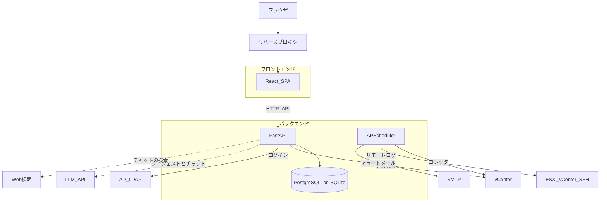
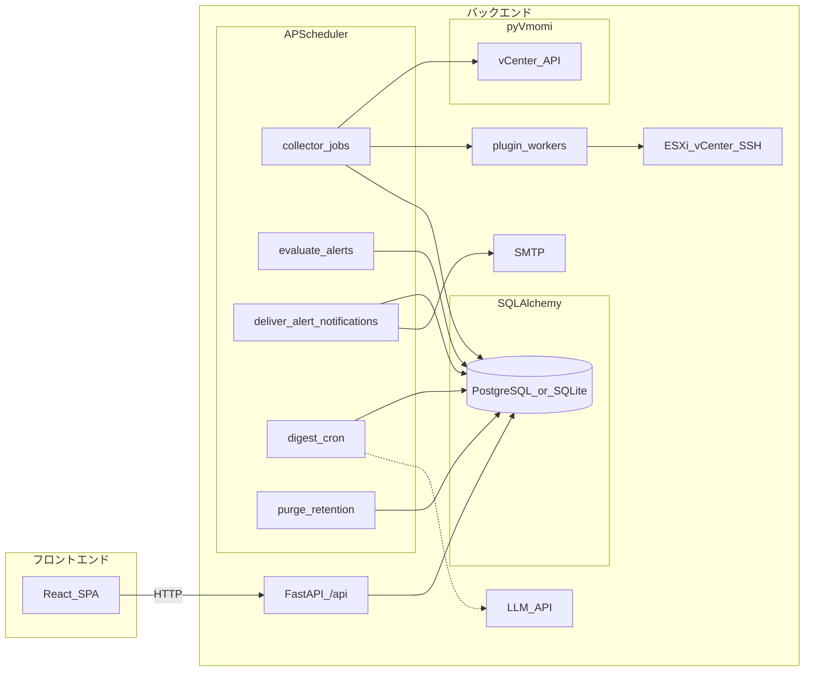

# アーキテクチャ

本書は vCenter Event Assistant の**構成とデータの流れ**を、図で把握するための入口である。[現状実装ベースのプラン](../plans/2026-03-21-vcenter-event-assistant-as-built.md) は作成時点の記録であり、現行の構成説明の正本は本書とする。

## バックエンド

- **役割**: HTTP API（`/api`）、永続化、認証、vCenter およびプラグイン経由の収集、定期ジョブ、環境設定に応じた LLM 呼び出し（ダイジェスト要約・チャット、ベータ）などを担う。
- **実装の所在**: [`src/vcenter_event_assistant/`](../../src/vcenter_event_assistant/)（エントリは [`main.py`](../../src/vcenter_event_assistant/main.py) の `create_app()`）。
- **主要要素**: **FastAPI**、**SQLAlchemy**（`DATABASE_URL` で **PostgreSQL** または **SQLite**）、**pyVmomi** による vCenter 接続、**コレクタレジストリ**（組み込みコレクタと外部パッケージ、リモートログは SSH）、**APScheduler** による定期ジョブ、アプリ内蔵のログイン（Cookie セッション、ローカルユーザーと **AD / LDAP**）とロール（admin / operator / viewer）による認可。本番ではビルド済みの `frontend/dist` を同一プロセスから配信できる。

## フロントエンド

- **役割**: ダッシュボード・イベント一覧・ログ・グラフ・ダイジェスト・通知履歴・チャット・タイムライン・設定などの UI を **SPA** として提供し、バックエンドの **`/api`** を呼び出す。
- **実装の所在**: [`frontend/`](../../frontend/)（**Vite 5** + **React** + **TypeScript**）。
- **開発時**: [`frontend/vite.config.ts`](../../frontend/vite.config.ts) が `/api` および `/health` をバックエンドへプロキシする。ブラウザは Vite の開発サーバに接続し、API だけが別ポートの FastAPI へ転送される。

## システムコンテキスト

利用者はブラウザから **フロントエンド**にアクセスする。**ログインとロールによる認可はアプリ自身が行う**（Cookie セッション、ローカル DB ユーザー、任意で AD / LDAP）。本番では **TLS 終端とネットワーク制限をリバースプロキシ側**で行う想定である。**バックエンド**では **APScheduler** がコレクタ（組み込みのイベント／メトリクスと外部プラグイン）、アラート評価、通知配送、保持期限の削除、ダイジェスト（日次・週次・月次）、検索プロバイダ設定時の Web 調査を定期実行する。組み込みコレクタは **pyVmomi** 経由で vCenter から取得し、同梱のリモートログプラグインは **SSH** で ESXi / vCenter のログを差分収集する。手動収集や API 経由の操作は **FastAPI** 側から同様に収集処理へ繋がる。環境設定により **LLM API**（ダイジェスト要約・チャット、ベータ）や **Web 検索**（チャット）を利用する。

リバースプロキシ・AD/LDAP・SSH（リモートログ）・SMTP・LLM・Web 検索は任意である。DB は PostgreSQL または SQLite。本番では多くの場合、フロントの静的ファイルと API が **同一オリジン**（`create_app()` による `frontend/dist` 配信）で提供される。APScheduler も同一プロセス内で動作する。下図は論理的な役割の分離を示す（プラグインワーカーの詳細は次節）。

## データフロー（内部）

### フロントエンドからバックエンド API へ

**React SPA** は **`FastAPI /api`** に HTTP でリクエストし、画面に一覧・グラフなどを表示する。`/api` は同一 DB を参照する。

### バックエンド内の収集・評価・永続化

**APScheduler** のコレクタジョブが、コレクタレジストリに登録されたプラグインを実行し、結果を **DB** に保存する。組み込みコレクタは **pyVmomi** で vCenter に接続し、外部プラグイン（同梱のリモートログなど）はワーカー経由で **SSH** 等に接続する。手動収集も同様にバックエンド経由で DB へ書き込む。

**`evaluate_alerts`** が DB 上のイベント・メトリクスを評価し、発火・回復を記録する。**`deliver_alert_notifications`** が送信予定を取り出して SMTP へ配送する。ダイジェスト cron は DB を読み、設定時だけ LLM を呼ぶ。**`purge_retention`**（ジョブ ID は `purge_metrics`）は期限切れのイベントとメトリクスを削除する。検索プロバイダが構成されているときは Web 調査ジョブも登録される。

## 関連ドキュメント

- [現状実装ベースのプラン](../plans/2026-03-21-vcenter-event-assistant-as-built.md) — 作成時点のリポジトリ構成・モジュール対応メモ（現行の図は本書を正とする）
- [フロントエンド画面の説明](../development/frontend.md)
- [コレクタプラグイン（運用）](../operations/collector-plugins.md)
- [アラート（利用者向け）](../userguide/alerts.md)
