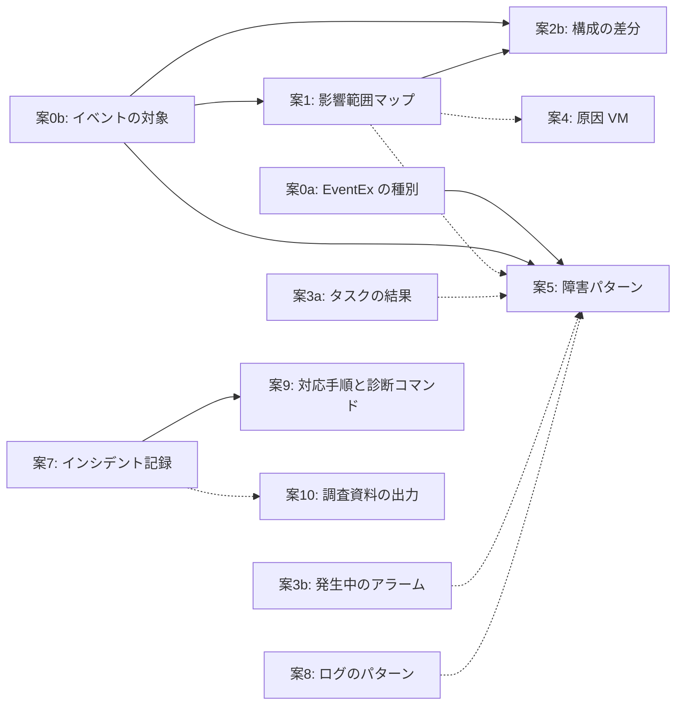

# 障害調査を楽にする機能 10 案の評価と進め方

本メモは、vSphere 環境で障害が起きたときの調査を楽にする機能を 10 案出し、同じ尺度で評価して進め方をまとめたものである。LLM を使う案は [AI活用アイデア20案](2026-05-07-ai-idea-backlog-20.md) にあるので、ここでは収集・見せ方・調査の進め方を中心にする。

各案の詳しい設計と PR の分け方は、着手する案を決めてから別の計画書に書く。

本メモでは、vCenter の管理対象（ホスト、VM、データストアなど）を一意に指す ID（`host-10` のような値）を **moid** と呼ぶ。

## 1. 前提（コードを確認して分かったこと）

### イベントの収集には不具合が 2 つある

イベントは EventManager から全種別を取っているが（`src/vcenter_event_assistant/collectors/events.py`）、保存するときに次の 2 つの情報を落としている。どちらも今のタイムラインやアラートに影響する不具合であり、本メモの案の多くの前提にもなる。

- **EventEx 型のイベントは本当の種別を失う**。`normalize_event` はイベントのクラス名（`type(e).__name__`）だけを種別として保存し、`eventTypeId` を捨てている。APD/PDL や NIC のリンクダウンなど、ESXi の `esx.problem.*` 系の多くは EventEx 型なので、今のデータではどれも同じ種別に見える。`src/` のどこにも `eventTypeId` は出てこない。
- **イベントの対象はほとんど取れていない**。`normalize_event` は `e.entity` しか見ないが、イベントの基底型には `entity` がなく、対象は `host`・`vm`・`ds`・`net`・`dvs`・`computeResource`・`datacenter` の各属性にある（EventEx では `objectId`・`objectType`・`objectName`）。たとえば `HostConnectionLostEvent` では、対象の名前も種別も空になる。`entity` を持つアラームのイベントでも、`entity_type` には `ManagedEntityEventArgument` が入る。moid はどの場合も保存していない。1 件のイベントが複数の対象を持つので、直すには保存の形から決める必要がある。

### 収集していないもの

- **いま発生中のアラーム**（`triggeredAlarmState`）。`AlarmStatusChangedEvent` はイベントとして入るが、状態が変わった瞬間しか残らない。
- **タスクの結果と所要時間**（`TaskHistoryCollector`）。`TaskEvent` はタスクの開始を表すだけで、失敗したかどうかは分からない。
- **対象どうしの関係**。moid から名前を引く処理（`src/vcenter_event_assistant/services/alerting/alert_entity_resolution.py`）はメトリクスの記録を使うだけで、VM→ホスト→クラスタ、データストアといった親子の関係はない。

### プラグイン API で足せる範囲

- 扱えるデータは event・metric・log の 3 種類だけである（`packages/plugin-api/src/vcenter_event_assistant_plugin_api/__init__.py` の `DataKind`、`PLUGIN_API_VERSION = 1`）。
- イベントは `(vcenter_id, collector_id, vmware_key)` で重複を捨てるだけで、取り込んだ行を後から更新・削除できない。そのため次のようになる。
  - 完了したタスクは、`task-NNN` の数字をキーにすればイベントとして出せる。
  - 「いまの状態」である発生中のアラームは、プラグイン API では作れない。本体に表・API・画面が要る。
- `entity_type` は長さの上限（メトリクス 128 文字、イベント 256 文字）だけを見る自由な文字列なので、VM を対象にしたメトリクスも出せる。メトリクスの閾値のアラートルールは、`context_key` を対象の種別によらず `{vcenter_id}:{entity_moid}` の形で持つので、VM にも使える（イベントスコアのルールは `context_key` にイベントの種別を入れるので、対象を持たない）。
- 本体に組み込まれたコレクタ（`src/vcenter_event_assistant/plugins/builtin.py`）も、プラグイン API の `EventCollector` と `MetricCollector` を使って本体の中で動いている。本メモでは、この形で足すものを **組み込みコレクタ** と呼ぶ。

### 保持期間の既定値

`src/vcenter_event_assistant/settings.py` による。

| データ | 既定の保持期間 |
|---|---|
| イベント・メトリクス・ログ | 7 日 |
| 通知履歴 | 90 日 |
| タイムラインのスナップショット（保存した結果を含む） | 90 日 |
| ダイジェスト | 365 日 |

7 日を過ぎた障害では、イベント・メトリクス・ログの生データが消え、通知履歴、スナップショット、ダイジェストが残る。イベントに付けたコメント（`EventRecord.user_comment`）はイベントと一緒に 7 日で消える。

### すでにあるもの

- **スナップショット**は、メモ、手動と自動の区別、発火の根拠、グラフの文脈、表示条件と結果を持てる（`IncidentTimelineManualSnapshot`）。ただし、結果を保存するのは画面から手動で保存したときだけである（`src/vcenter_event_assistant/api/routes/incident_timeline.py`）。アラートの発火時に自動で保存するスナップショット（`src/vcenter_event_assistant/services/incident_timeline_snapshot.py`）は条件と根拠しか持たないので、7 日を過ぎて開くと中身が空になる。保存した結果も、各行の詳細は 2000 文字まで、全体は 8 MB までに切られる。
- **イベントのコメント**は、operator ロール以上の利用者が付けられる。
- **出力**は、ログ・イベント・メトリクスの CSV、グラフの SVG、ダイジェストのダウンロードがある。タイムラインとスナップショットには出力がない。
- **イベントの重要度の判定**には、スコアルール、`src/vcenter_event_assistant/rules/notable.py`、イベントスコアのアラートルールがある。どれもイベントを 1 件ずつ見るだけで、複数のイベントの並びは見ない。

### リモートログの SSH 接続

- SSH アカウントには、ログを読む権限が要る。vCenter では Bash を実行できることも条件である（[リモートログ収集](../userguide/remote-log-collector.md)）。
- 分離モードでは、リモートに認証して接続するのはプラグインのワーカーだけで、鍵は認証済みのソケットで渡している（[コレクタプラグイン](../operations/collector-plugins.md)）。本体は、ホスト鍵を取得するときだけ認証なしで接続する。

## 2. 評価表

導入コスト・期待効果・運用負荷を、大・中・小の 3 段階で評価する。間に入るものは「小〜中」のように書く。

10 案に加えて、イベントの収集の不具合を直す作業を土台として #0a・#0b に置く。#3 は作る場所が違うので 3a（タスクの結果）と 3b（発生中のアラーム）に、#2 は前提が違うので第 1 段（#2a）と第 2 段（#2b）に分ける。「前提」の列には、先に済ませておく必要がある案だけを書く。あると良くなる関係は「3. 依存関係」に書く。

| # | 案 | 導入コスト | 期待効果 | 運用負荷 | 前提 | 実装の場所と、新しく足す部分 |
|---|---|---|---|---|---|---|
| 0a | （土台）EventEx の種別を保存する | 小〜中 | 大（今のタイムラインやアラートでも、ESXi の problem 系が見分けられる） | 小 | なし | 本体。`eventTypeId` を種別として保存する。既存のスコアルールとイベント種別ガイドは種別名で引くので、既存の行と設定の扱いを決める必要がある |
| 0b | （土台）イベントの対象を正しく取る | 中 | 大（今のタイムラインやアラートでも、ホスト系のイベントの対象が見える） | 小 | なし | 本体。`host`・`vm`・`ds` など（EventEx では `objectId`・`objectType`・`objectName`）から対象の名前・種別・moid を取る。1 件に複数の対象があるので、列を増やすか子表を作るかを決める。変更は `collectors/events.py`、DB の移行、プラグイン API の `EventInput`（minor 版で足りる）、`plugins/wire.py`・`plugins/runtime.py`・`plugins/builtin.py`、API のスキーマ、画面に及ぶ |
| 1 | 影響範囲マップ | 大 | 大 | 中（定期的な収集、表が増える） | #0b | 本体。インベントリの関係を集める新しい表を作り、障害が起きた対象から、影響を受ける VM、共有データストア、ポートグループをたどれるようにする |
| 2a | [構成変更の追跡（第 1 段）](2026-11-24-config-changes.md) | 小 | 中 | 小 | なし | 本体。すでに集めている構成変更のイベントを、タイムラインで目立たせる。[AI活用アイデア20案](2026-05-07-ai-idea-backlog-20.md) の 9 番「変更イベント相関分析」と同じ方向である |
| 2b | 構成変更の追跡（第 2 段） | 中 | 大 | 中（記録の容量） | #0b、#1 | 本体。ESXi のビルド、HA/DRS の設定、vSwitch、マルチパス、VM の構成を記録して差分を出し、イベントの対象と結び付ける |
| 3a | [タスクの結果と所要時間](2026-11-24-task-results.md) | 小 | 中〜大 | 小 | なし | 組み込みコレクタ（`EventCollector`）。完了したタスクだけを入れる。障害の時点で止まっている実行中のタスクは見えない |
| 3b | 発生中のアラーム | 中 | 大 | 小 | なし | 本体。新しい表・API・画面が要る。状態が変わるので、取り込んだ行を更新する仕組みも要る。実行中のタスクも同じ仕組みで見せられる |
| 4 | 原因 VM の特定 | 中 | 中〜大 | 中（VM のメトリクスが増える） | なし | 組み込みコレクタ（`MetricCollector`）。ホストが高負荷のときだけ、そのホストの VM（`host.vm`）をたどり、VM ごとの CPU Ready、Co-Stop、バルーニング、スワップ、ディスクレイテンシの上位を取る。グラフとタイムラインが VM を正しく扱えるかは、着手するときに確かめる |
| 5 | 既知の障害パターンの検知 | 中 | 大 | 小〜中（パターンの保守） | #0a、#0b | 本体。APD/PDL、HA のフェイルオーバー、ホストの切断と再接続の繰り返し、NIC のリンクダウン、vMotion の連続失敗などを、同じ対象に起きた複数のイベントやログの並び（順序と時間幅）で判定する。1 件ずつ見るスコアルールとは分ける。パターンはイベント種別ガイドと同じく JSON で入れ替えられるようにする |
| 6 | 平常時との比較 | 中 | 中 | 中（長期用の集計表） | なし | 本体。1 時間単位の集計を長期保存し、同じ曜日・同じ時間帯と比べて外れている指標やイベント種別を強調する。SQLite での増え方を見積もってから作る |
| 7 | インシデント記録 | 小〜中 | 大 | 小 | なし | 本体。スナップショットにすでにあるもの（メモ、根拠、保存した結果）を使い、足りない「状態・担当・複数のスナップショットやイベントのまとめ」だけを足す。イベントのコメントは 7 日で消えるので、インシデント側にメモを持たせる |
| 8 | ログのパターン集約 | 小〜中 | 中〜大（リモートログを使う環境に限る） | 小 | なし | 本体。`LogRecord` に、数値や ID を伏せた型のキーを足す。型ごとに件数をまとめ、初めて出た型を目立たせる |
| 9 | 対応手順と読み取り専用の診断コマンド | 大 | 中〜大 | 大（許可リスト、専用の認証情報、監査） | #7 | 手順の表示は本体で行う。コマンドの実行は本体から SSH せず、ワーカーに任せる（分離モードの設計を回り込まないため）。admin だけが使え、許可したコマンドだけを動かし、監査記録を残し、ログ収集とは別の認証情報を使う。本体の許可リストは安全上の境界にならないこと、ESXi の診断コマンドは強い権限を要するものが多いことを、設計の前提に書く |
| 10 | 調査資料の一括出力 | 小 | 中 | 小 | なし | 本体。足りないのはタイムラインとスナップショットの出力だけである（CSV と SVG はすでにある）。7 日を過ぎた障害は生データが消えるので、手動で保存したスナップショットの結果を出す。自動のスナップショットにも結果を残すかは、アラート評価の負荷と合わせて別に決める。出力するのは上限付きの要約なので、障害報告や引き継ぎに添える資料にとどまり、ベンダーのサポートが求めるサポートバンドルの代わりにはならない |

## 3. 依存関係

実線は前提、点線は「あると精度や使い勝手が上がる」関係である。図にない #2a・#6 は、ほかの案と関係しない。

- #0a は #5 の前提になる（ESXi の problem 系のイベントを見分けるため）。
- #0b は #1・#2b・#5 の前提になる（イベントと対象を moid で結ぶため）。
- #1 は #2b の前提になり、#4（ホストと VM の関係を画面で見せる）と #5（同じクラスタやデータストアでまとめる）を良くする。
- #7 は #9 の前提になる（手順を実施した結果をインシデントに残す）。#10 は #7 があると、インシデント単位でまとめて出せる。
- #3a・#3b・#8 は #5 の判定の材料になる。

## 4. 進め方

| 段階 | 内容 | 理由 |
|---|---|---|
| 0. 収集の不具合を直す | #0a → #0b | 今のタイムラインやアラートにも効き、#1・#2b・#5 の前提になる |
| 1. すぐ効くもの | #10 → #3a → #8 → #2a | 小さく、今あるデータと仕組みで作れる |
| 2. 単独で効果の大きいもの | #3b、#7、#4 | ほかの案に頼らずに作れる。#3b は本体に新しい表が要る |
| 3. 関係を集める | #1 → #2b | #0b の上に作る |
| 4. 集めたデータを使う | #5 | #0a・#0b を前提にし、#1・#3a・#3b・#8 があると精度が上がる |
| 5. 長期データ | #6 | 新しい保存領域が要るので、SQLite での増え方を見積もってから作る |
| 6. 最後 | #9 | 安全面の設計が最も重い |

PR の数の目安は次のとおりである。段階 3 以降は粗い見積もりで、正確な分け方は各案の計画書で決める。

| 案 | PR の数の目安 |
|---|---|
| #0a | 1〜2 |
| #0b | 2〜3 |
| #10 | 1〜2 |
| #3a | 1〜2 |
| #8 | 2 |
| #2a | 1 |
| #3b | 2〜3 |
| #7 | 2 |
| #4 | 2 |
| #1 | 3〜4 |
| #2b | 2〜3 |
| #5 | 2〜3 |
| #6 | 2〜3 |
| #9 | 3 以上 |

## 5. README の「対象外」との関係

[README](../../README.md) の「制約、その他」に書いた範囲を超えないようにする。

- **#4**: VM の詳細なキャパシティ計画はしない。ホストが高負荷のときの上位数件だけを取る。
- **#6**: 長期の集計は傾向を見るためのもので、監査の証跡ではない。
- **#7**: インシデント記録には改ざん耐性がないので、証跡にはならない。保持期間はスナップショットに合わせる。インシデントが参照するスナップショットが先に消えたときの扱いは、#7 の計画書で決める。
- **#9**: 本番環境で強い権限のコマンドを動かすので、使うかどうかは運用側の判断に任せ、既定では無効にする。
- **#10**: 調査資料の出力であって、SIEM の代わりや唯一の証跡にはしない。

## 6. 次の手順

**段階 0 の #0a（EventEx の種別を保存する）から着手する**ことを勧める。今のタイムラインやアラートの不具合を直すものであり、#5 の前提でもあるからである。#0a は Issue #346、#0b は Issue #347 として起票した。それぞれ計画書を作る。

段階 0 のあとは、#10（手動で保存したスナップショットの結果の出力）を勧める。小さく作れて、保存した結果をそのまま使えるからである。
