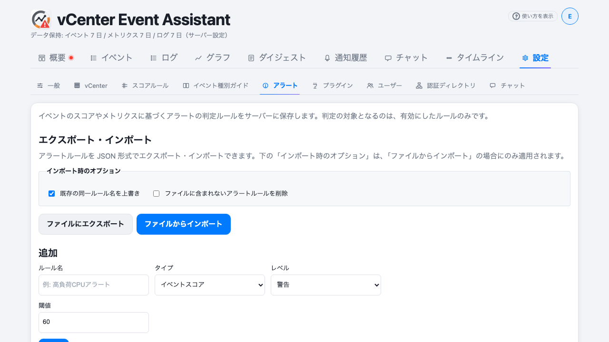
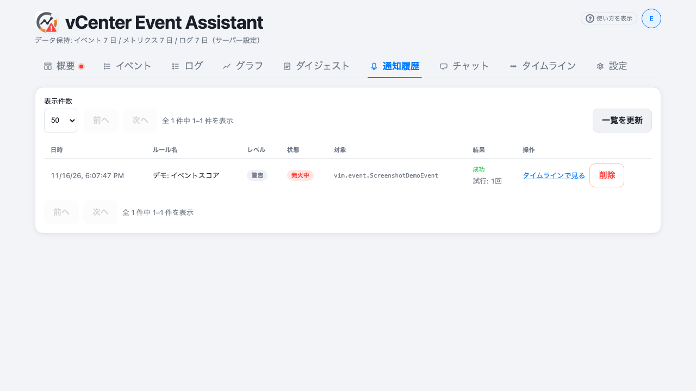

# アラート機能の使い方（利用者向け）

<!-- vea-tab-help: alerts -->

vCenter Event Assistant の **アラート** は、主に **メール通知** と **画面での確認** の2系統がある。本書は開発者向けではなく、ルール設定・通知対応・障害調査の担当者向けに、現行の挙動をまとめたものである。

---

## 1. この文書の対象と読み方

| 役割 | まず読む節 | 目的 |
|-------------|-----------|------|
| **運用（設定）** — ルールを作る・変更する | [§4](#4-アラートルールの種類と重大度レベル) → [§7 設定](#7-画面別操作) | いつメールが飛ぶかを定義する |
| **運用（受信）** — メールを受け取って対応する | [§6](#6-メール通知の見方と対応の目安) | 件名・本文の読み方と優先度 |
| **障害調査** — 履歴やタイムラインで追う | [§7 通知履歴・タイムライン](#7-画面別操作) → [§8](#8-よくある質問と切り分け) | 発火・回復の時系列と送信結果 |

用語が似ているので、次の4つを区別する。

| 用語 | 意味 |
|------|------|
| **要注目スコア** | イベント一覧に表示される重要度（数値）。スコアルールで調整される。 |
| **アラートルール** | **設定 → アラート** で定義する「メールを送る条件」。 |
| **通知履歴** | メインタブ **通知履歴** に記録される、発火・回復と送信結果の一覧。 |
| **タイムラインのアラート** | **タイムライン** タブに出る、通知履歴の発火・回復の行。タイムラインはメールを送らない。 |

---

## 2. アラート機能の全体像

1. vCenter から **イベント** と **ホストメトリクス**（CPU/メモリなど）を定期的に取り込む。
2. **スコアルール** で各イベントに **要注目スコア** を付ける。
3. **アラートルール** が一定間隔で条件を評価する。**メトリクス閾値型** は閾値超えで **発火**、計測が閾値未満に戻ると **回復** として記録される。**イベントスコア型** は **発火・再通知** を記録するが、**自動の回復はしない**。**障害パターン型** は、検知で発火し、検知が範囲から外れると自動で解消する（§5）。
4. 発火・通知を伴う回復・再通知のたびに **通知履歴** に行が追加される。SMTP が設定されていれば **メールの送信予定** も保存され、独立した配送ジョブで送られる。
5. **タイムライン** では、通知履歴の発火・回復を、同じ期間のイベント・メトリクスの超過・エラーログと並べて表示する（メールは送らない）。

```
[イベント/メトリクス取り込み]
        ↓
[スコアルール] → 要注目スコア
        ↓
[アラートルール] → 定期評価 → 発火 / 回復
        ↓                    ↓
[通知履歴タブ]          [メール（SMTP 設定時）]
        ↓
[タイムライン] ← 通知履歴・イベント・メトリクス・ログを並べた調査用の表示（メールなし）
```

※ **イベントスコア型** は **自動の「回復」** を行わない（§5）。図中の「回復」は **メトリクス閾値型** を主に指す。

### 2.1 通知履歴タブのアテンションドット

**通知履歴** タブのラベルには、他のタブを開いていても発火中のアラートに気づけるよう、条件を満たすと **赤いドット** が付く。

| 項目 | 内容 |
|------|------|
| 表示条件 | **有効な** アラートルールで、現在 **発火（firing）中** のアラートが **1 件以上** ある |
| 対象外 | **無効化したルール** に残っている firing 状態は数えない。**resolved / stale** も対象外 |
| 更新頻度 | 約 **60 秒ごと** に自動更新（「設定 → 一般」の自動更新設定とは **独立** して動く） |
| 消える条件 | firing がすべて解消されたとき。**メトリクス閾値型** は計測値が閾値未満に戻ると自動で回復する。**イベントスコア型は自動回復しない**（§5）ため、対処後に通知履歴の **「解消」** 操作で firing を解消するとドットも消える。**障害パターン型** は検知が範囲から外れると自動で解消する |
| 取得失敗時 | ドットを表示しない（エラーにはならず、次回の更新で回復する） |

なお、**概要** タブにも同様のドットがあり、こちらは直近 24 時間の **要注意イベント（スコア 40 以上）** の有無を示す（詳細は [概要タブガイド](summary.md) を参照）。

---

## 3. 要注目スコアとスコアルール（通知の前提）

- **要注目スコア** は、イベントの重要度（0〜100）である。**イベントスコア型のアラート** は、このスコアがルールの **閾値以上** かどうかで判定する。
- **スコアルール**（**設定 → スコアルール**）でスコアを変えると、同じイベントでも通知の出方が変わることがある。スコアの意味・設定手順・再計算の詳細は **[スコアルールの使い方](score-rules.md)** を参照する。
- イベント行の **重大度（severity）** は VMware 由来の分類で、**アラートのレベル（クリティカル・エラー・警告）とは別物** である。運用上の緊急度はアラートルール側のレベルを参照する。

---

## 4. アラートルールの種類と重大度レベル

**設定 → アラート** でルールを管理する。有効にしたルールだけが評価される。

### ルールの種類（タイプ）

| 画面での名称 | 判定内容 | 対象の例（通知の「対象」列） |
|-------------|---------|---------------------------|
| **イベントスコア** | 要注目スコアが **閾値以上** のイベントがある | イベント種別名（例: `vim.event.UserLoginSessionEvent`） |
| **メトリクス閾値** | 指定メトリクスが **閾値以上** のホストがある | ホストの識別子（内部 ID。メール本文の Details にホスト名が出る場合あり） |
| **障害パターン** | 組み込みの障害パターンに該当するイベントの並びがある | ホストやクラスタの名前・識別子（moid） |

- **イベントスコア型** の状態は **イベント種別（`event_type`）単位** である。通知履歴・メールの **対象** に出るイベント種別名が、そのまま内部的な状態のキー（`context_key`）に対応する。**メトリクス閾値型** は **ホストごと** に状態を持つ。
- 新規作成時、イベントスコア型は **再通知間隔（分）**（サーバー側の設定キーは `cooldown_minutes`）が既定 10 分で付く（行の編集から変更可能）。
- メトリクス型は **メトリクスキー** を、グラフタブやキー一覧と **完全一致** させる（例: CPU 利用率 `host.cpu.usage_pct`）。キーが DB のサンプルと一致しないと発火しない。グラフの見方は [graph.md](graph.md)。
- 障害パターン型は、**対象のパターン** を複数選べる。選択を空にすると、今後追加されるものも含め、組み込みのすべてを判定する。JSON では `config.pattern_ids` に ID の配列を指定し、空配列はすべてを表す。定義にない ID を含むルールは保存・インポートできない。
- 障害パターン型の **再通知間隔（分）**（`config.cooldown_minutes`）は既定 10 分で、作成時と行の編集で変更できる。通知のレベルにはルールの設定を使い、本文にパターン自体のレベルも出す。

### 重大度レベル（クリティカル・エラー・警告）

ルールごとに1つ選ぶ。メールの件名と **通知履歴** の「レベル」列に反映される。

| レベル | 運用上の目安 |
|--------|-------------|
| **クリティカル** | サービス影響の可能性が高く、**すぐ**対処が必要 |
| **エラー** | サービス影響の可能性が高く、**対処が必要** |
| **警告** | 直接的なサービス影響は想定しにくく、**状況の検討**が必要 |

新規ルールの既定レベルは **警告** である。重要なルールは運用方針に合わせて引き上げる。

### ルールのバックアップ

- **ファイルにエクスポート** / **ファイルからインポート** で JSON のやり取りができる。エクスポートは operator 以上、インポートは admin だけが使える（viewer にはどちらも表示しない）。
- インポート時の「ファイルに含まれないルールを削除」に注意する。誤操作で既存ルールが消える可能性がある。

---

## 5. 発火・回復・再通知・再通知間隔

アラートは **発火（firing）** と **回復（resolved）** の2状態で表現される。**メトリクス閾値型** はこれまでどおり、「閾値超え」と「計測値が閾値未満に戻る」とで発火／回復が切り替わる。**イベントスコア型** は、イベントがいったん途切れても **自動では回復しない**。通知履歴に **発火が間欠的に続く** のは、**再通知間隔** に同期した評価・送信の結果であることがある。

**イベントスコア型の「クールダウン（分）」／画面の「再通知間隔（分）」（`cooldown_minutes`）** は、**同じイベント種別へのメール再送の最小間隔** である。**イベントがしばらく出なくなっても自動では回復しない**。調査完了後は **通知履歴** の **解消** ボタンで手動解消できる（回復メールが送信され、再通知が止まる）。**メトリクス型** は従来どおり、**計測値が閾値を下回ると自動で回復** する。

| 項目 | イベントスコア型 | メトリクス閾値型 |
|------|------------------|------------------|
| 状態の単位 | イベント種別（`event_type`）ごと | ホストごと |
| 自動での回復 | **しない**（沈黙・ウィンドウ外だけでは resolved にならない。**通知履歴の解消**で手動回復） | **する**（閾値未満へ戻ると回復） |
| メール・履歴での再通知 | **同じ種別** で、条件を満たしたうえで **前回の送信から「再通知間隔（分）」以上経過したときのみ**。**間隔より速いイベントの連発だけでは増えない** | 閾値超えが **継続している間は送らない**。回復後に再び超えたときに再発火 |
| ウィンドウ | 評価ウィンドウ内のイベントのみ対象（長さは管理者設定） | （該当なし／ホストの最新評価） |

### 共通

- **メトリクス閾値型** について、**発火**: 閾値超えで、そのホストが未発火または回復済みだったとき → **発火** 通知が1回。**回復**: 計測が閾値未満に戻ったとき → **回復** 通知が1回。
- **イベントスコア型** については、初回発火時や上表のとおりの **再通知** のほか、「回復」の自動遷移は **しない**（上表・冒頭説明）。

### イベントスコア型

- **判定対象**: イベント一覧と同じ **要注目スコア** が閾値以上で、かつ **直近一定時間内**（評価ウィンドウ）に発生したイベント。ウィンドウの長さはサーバー管理者が設定する（ルールごとの設定項目ではない）。
- **発火・再通知**: ウィンドウ内に閾値以上のイベントがあり、**そのイベント種別** について（初回、または前回のメール送信から **再通知間隔（分）** 以上が経過したうえで）条件を満たすと、**発火** 相当の通知が **おおよそ間隔どおり** 記録・送信される。**同じ種別で間隔未満のあいだに新しい閾値以上イベントがあっても、追加のメールは送らない**（「より新しいイベントが来るたびに毎回送る」挙動ではない）。
- **継続（再通知なし）**: 上記の再通知条件を満たさない間は、**同じ種別への追加メールはない**。
- **回復（自動）**: **ない**。イベントが途切れても、経過時間だけで **回復** 通知は出ない。

### メトリクス閾値型

- **ホストごと** に状態を持つ。ホスト A が閾値超え、ホスト B が正常、といった組み合わせが可能である。
- あるホストで閾値超え → そのホスト向けに発火。値が閾値未満に下がる → そのホスト向けに回復。
- 閾値超えが **続いている間は再通知しない**（ホストごとの状態更新のみ）。回復後に再び超えたときだけ再発火する。

### 障害パターン型

- **判定対象**: 全 vCenter のイベントを、パターンごとに評価ウィンドウの開始よりパターンの時間幅だけ前から読む。検知に使ったイベントが評価ウィンドウに 1 件以上入る検知を対象とする。
- **発火・再通知**: vCenter・moid・パターンの組ごとに、最も新しい検知の終了時刻で判定する。初めて検知したときに発火する。発火中は、検知の終了時刻が進み、前回の通知登録から再通知間隔が経過していれば再通知する。間隔内に進んだ終了時刻は取り込み済みとして記録し、その検知は間隔が過ぎても送り直さない。
- **自動での解消**: 検知が評価範囲から外れたり、ルールの対象からパターンを外したりすると解消する。回復のメールと通知履歴は作らない。行数の上限などで判定を見送ったパターンは、その評価では状態を変えない。
- **手動での解消**: 通知履歴の **解消** で発火状態を解消し、回復通知を登録する。解消後は、自動・手動どちらの場合も、それまで記録した終了時刻より新しい検知で再発火する。

### 評価のタイミング

- サーバーはおおむね **1分ごと**（管理者が変更可能）に有効ルールを評価する。メールが届くまでに最大でその程度の遅れがあり得る。

---

## 6. メール通知の見方と対応の目安

SMTP と送信先がサーバー側で設定されているときだけ、メールが配信される（未設定でも **通知履歴** には記録される場合がある）。

### 件名の形式（既定テンプレート）

| 状態 | 件名の例 |
|------|---------|
| 発火 | `[FIRING][warning] ルール名 - vim.event.ExampleEvent` |
| 回復 | `[RESOLVED][error] ルール名 - host-123` |

- 角括弧内の `critical` / `error` / `warning` はレベルである。本文にも日本語ラベル（クリティカル等）が含まれる。
- **Resource**（対象）行は、イベント型では **イベント種別名**、メトリクス型では **ホスト識別子** である。
- **Details** にスコアやメトリクス値、メッセージの要約が入る。

### 受信時の対応の目安

1. 件名の **レベル** で優先度を判断する（§4 の表）。
2. **ルール名** でどの条件に引っかかったかを把握する。
3. **Resource** でイベント種別かホストかを切り分ける。
4. 必要ならアプリの **イベント** タブや **グラフ** タブ、**タイムライン** で前後を確認する。

---

## 7. 画面別操作

### 設定 → アラート



- **追加**: 「追加」の見出しの下のフォームで、ルール名、タイプ（イベントスコア / メトリクス閾値 / 障害パターン）、レベル、タイプに応じた条件を指定し、**追加** を押す（admin だけ）。
- 一覧はイベント種別ガイドと同じ折りたたみの行である。閉じた行にはルール名・レベル・タイプ・条件（スコアの下限、メトリクスキーと閾値、または対象のパターン）と、無効なら「無効」を表示する。
- 行をクリックして開き、ルール名・レベル・有効（判定の対象にするか）・タイプに応じた条件や再通知間隔を変えて **保存** する（admin だけ。viewer と operator は内容の確認だけ）。**タイプは後から変更できない**（作り直しが必要）。
- 編集して保存するまでの間に、インポートや別の画面での変更で、自分が変えた項目がサーバー上でも別の値に変わった場合は、行に **ほかの操作で変更あり** と表示され、上書きを防ぐため **保存** できなくなる。**編集を破棄して読み直す** を押して最新の内容を確認してから、改めて編集する。自分が変えていない項目の変更は、そのまま最新の値が表示される。

### 通知履歴（メインタブ）



| 列 | 内容 |
|----|------|
| 日時 | 通知が記録された時刻（タイムゾーンは **設定 → 一般** に従う） |
| ルール名 | 発火したルール |
| レベル | クリティカル / エラー / 警告 |
| 状態 | **発火中** または **回復済み** |
| 対象 | イベント種別名、またはホストやクラスタなどの対象名・識別子 |
| 結果 | **配送待ち／再送待ち／成功／打ち切り／失敗／未送信**。試行回数・次回試行時刻を表示。エラーはマウスオーバーで確認 |
| 操作 | **解消**（イベントスコア型・障害パターン型で当該対象がまだ発火中のとき）／ **削除**（その履歴行のみ削除）／ **タイムラインで見る**（発生時刻の前後 30 分を[タイムライン](timeline.md)に開く） |

- **解消**: 調査完了後にイベントスコア型・障害パターン型の発火を解消し、回復通知を登録する。イベントスコア型では評価ウィンドウ内に閾値以上のイベントが残っていると再発火しうる。障害パターン型では検知の終了時刻が進んだときに再発火する。
- **削除**: 表示上の履歴行を 1 件だけ消す。**発火状態そのものは変わらない**。再通知を止めたい場合は **解消** を使う。
- **一覧を更新** で再読み込み。30秒ごとに自動更新される。
- 履歴が空でも、ルールが無効・閾値未満・評価待ちの可能性がある（§8）。

### タイムライン（メインタブ）

タイムラインの操作と見方は [timeline.md](timeline.md) を参照する。ここでは、アラートとの関係だけを示す。

- タイムラインの **アラート** の行は、通知履歴に記録された発火・回復である。タイムラインからメールは送られない。
- 通知履歴の行の「タイムラインで見る」から、発火・回復の時刻の前後を開ける。障害パターン型のリンクは vCenter と時刻だけを渡す。HA によるフェイルオーバーでは検知の対象がクラスタで、クラスタの moid で絞ると主な対象がホストや VM の関連イベントが一覧から外れるためである。

---

## 8. よくある質問と切り分け

### イベント一覧に高スコアがあるのに、メールも通知履歴もない

1. **設定 → アラート** で、該当条件のルールが **有効** か。
2. ルールの **閾値** が、一覧の要注目スコア **以下** になっているか（「60以上」ならスコア 59 では発火しない）。
3. イベントが **評価ウィンドウ（直近一定時間）の外** にあるだけでは発火しない（§5）。ウィンドウの長さは管理者に確認する。
4. **発火後の再通知間隔**: **イベントスコア型** は、同一イベント種別で **前回の送信から「再通知間隔（分）」未満** のとき、新しい閾値以上イベントがあっても **メールされない**（§5）。**メトリクス型** で、すでに発火中かつ値が閾値超えのままでは **再通知されない**（§5）。
5. メトリクス型なら **メトリクスキー** がグラフと一致しているか、データが取り込まれているか。

### ディスクの指標のルールが発火しなくなった

ディスク I/O の合計の指標は、名前が `host.disk.usage_pct` から `host.disk.usage_kbps` に変わった（値は以前から KB/s で、% ではない）。保存済みのルールは更新のときに新しい名前へ付け替わる。古い名前のままのルールの JSON を取り込むと、サンプルと一致せず発火しないので、取り込む前に `metric_key` を `host.disk.usage_kbps` に直す。

### 通知履歴は「成功」だがメールが届かない

- 履歴の成功は **アプリが送信処理を完了したこと** を示す。受信側の迷惑メール、転送設定、SMTP の From/To は **サーバー管理者** が確認する（[backend-operations.md](../operations/backend-operations.md) の SMTP 節）。

### 通知履歴が「失敗」になる

- 結果列にマウスオーバーするとエラー概要が出る。SMTP 認証・TLS・宛先の設定不備が多い。管理者に連絡する。

### 同じイベント種別で何度もメールが来る

- **イベントスコア型**: **再通知間隔（分）** を空けつつ閾値以上のイベントが続くと、その間隔に近いタイミングで **発火** として通知が繰り返されることがある（**自動の「回復」はしない** ので、履歴では **発火が連続** しているように見える場合がある）。
- メールの「何度も」は **閾値以上のイベントが短い間隔で大量にある**とは限らず、**評価周期と再通知間隔の組み合わせ** でも説明できることがある。§5 の **再通知** の条件と照らす。
- **イベントスコア型** で **問題が解消したあと履歴だけが発火続きに見える** 場合でも、自動 resolved はしない。**解消** ボタンで手動回復するか、調査・対応記録として履歴を残す。
- **メトリクス型**: 閾値超えが続く間は再通知しない。連続メールは別ルール・別ホスト・回復と再発火の繰り返しを通知履歴の **状態** 列で確認する。

### タイムラインにアラートが出るがメールが来ない

- タイムラインの **アラート** の行は、**アラートルールが有効で条件を満たし、発火遷移したとき** に記録された通知履歴である。行があるだけでは、メールが送られたことにはならない。
- メールの有無は、通知履歴の **結果** 列で確かめる（「配送待ち」「成功」「失敗」「未送信」など。§6・§8 の該当項目を参照）。

### 古いイベントで突然アラートが出た

- イベントスコア型は **評価ウィンドウ内** のうち、閾値以上で **最も新しい1件** だけを見る。ウィンドウ外の古いイベントだけが閾値を超えている場合は通常発火しない。ウィンドウ内の古いイベントで発火した場合は、ルール閾値・スコアルール・ウィンドウ設定（管理者）の見直しを検討する。

---

## 9. 関連ドキュメント

| 読者 | ドキュメント |
|------|-------------|
| **利用者（本書）** | 本ファイル |
| **利用者（要注目スコア・スコアルール）** | [score-rules.md](score-rules.md) |
| **利用者（ダイジェスト）** | [digests.md](digests.md) |
| **利用者（チャット）** | [chat.md](chat.md) |
| **利用者（概要タブ）** | [summary.md](summary.md) |
| **利用者（イベントタブ）** | [events.md](events.md) |
| **利用者（グラフタブ）** | [graph.md](graph.md) |
| **利用者（タイムラインタブ）** | [timeline.md](timeline.md) |
| **サーバー管理者**（SMTP・評価ウィンドウ・ログ） | [backend-operations.md](../operations/backend-operations.md)、[backend.md](../development/backend.md) §2.4 の `event_score` 節 |
| **開発者**（API・評価ジョブの詳細） | [backend.md](../development/backend.md) §2.4 |
| **イベント種別の意味** | [event-type-guides/README.md](../event-type-guides/README.md) |
| **チャットでの調査** | [chat.md](../features/chat.md) |

実装の変更履歴や設計メモは `docs/plans/` および `docs/superpowers/` にあるが、**利用者向けの正本は本書と画面の表示** とする。

---

## 付録: アプリ内ヘルプとの関係

メイン画面の「使い方を表示」には、通知履歴・タイムラインの要約のみがある。タイムラインの詳しい操作は [timeline.md](timeline.md) を参照する。**設定 → アラート** の説明は本書を参照する。内容の詳細版として本ガイドを利用できる。

### メールの自動再送

SMTP の一時障害・認証エラー時は再送待ちになり、既定で最大24時間再送する。通知履歴は試行ごとに増えず、同じ行を更新する。日時は配送待ちでは登録時刻、試行後は最新試行時刻である。旧履歴の試行回数は不明と表示される。

回復済み・ルール無効化後も登録済みの発火通知は届くことがある。送信先と文面は登録時に固定され、受理後の切断などでは重複メールが届く場合がある。履歴を削除すると待機中の通知も取り消す。送信開始済みメールは取り消せない。

未送信（SMTP／宛先未設定）、描画失敗、再送期限超過は自動再送されない。管理者に連絡し、必要に応じて別経路で通知内容を確認する。
