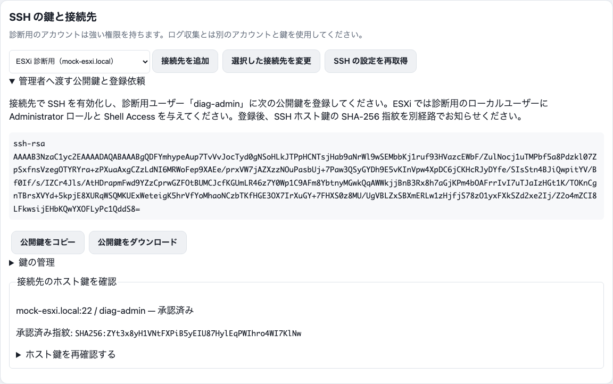
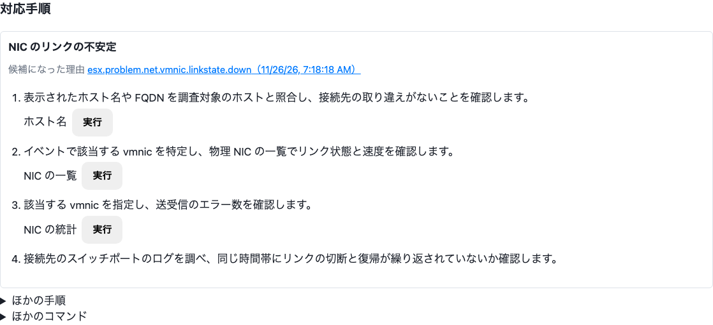
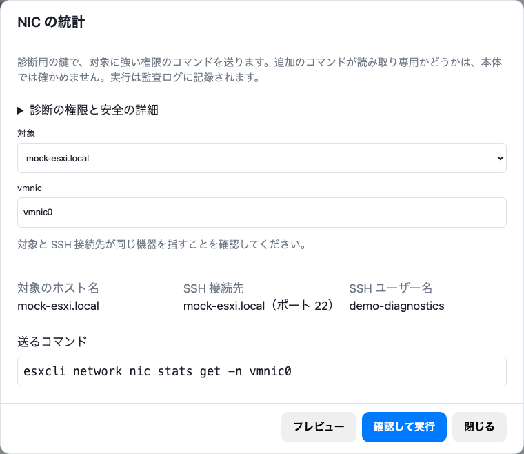
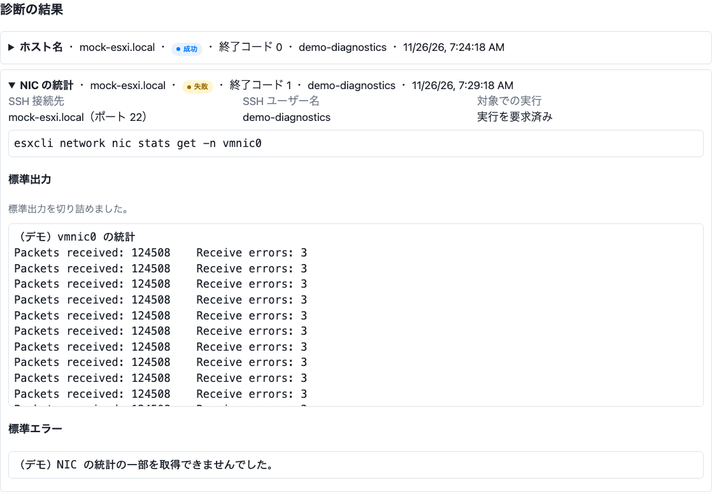

# 対応手順と診断コマンド

「インシデント」の詳細で、紐付けたイベントや通知に関連する対応手順を確認できます。診断を有効にすると、admin は同じ画面から ESXi や vCenter に SSH で診断コマンドを送り、結果をインシデントに残せます。対応手順と保存済みの結果は、診断が無効なときも viewer 以上が閲覧できます。

## 管理者の準備

1. サーバーに `VEA_DIAGNOSTICS_ENABLED=true` を設定し、再起動します。既定は無効で、画面からは有効にできません。診断を有効にして認証を無効にすると、本体は起動を拒否します。SSH の秘密鍵を暗号化するために `VEA_SECRET_KEY` も設定してください。
2. 診断を行う機器に、ログ収集とは別の専用アカウントを用意します。ESXi ではローカルユーザーに **Administrator** ロールと **Shell Access** を付けます。vCenter では、SSH でログインし、診断に必要なコマンドを Bash で実行できるようにします。vCenter の組み込みコマンドは、ログインシェルを Bash にした実機で確認しています。appliance shell から Bash を呼ぶ経路は実機では未確認です。
3. admin でログインし、**設定 → 診断** を開きます。診断用の SSH 鍵を生成または登録し、公開鍵を手順 2 のアカウントに登録します。
4. 診断用の接続先にホスト名・ポート・SSH ユーザー名と鍵を設定します。ホスト鍵を取得し、対象側で確認した指紋と一致したものを承認します。
5. **実行の対象** で vCenter を選び、ESXi または vCenter 自身を診断用の接続先に結び付けます。選んだ機器と SSH 接続先が同じ機器を指すことを確認してください。アプリはこの対応関係を照合しません。

組み込みのコマンドに加え、admin は **追加のコマンド** に雛形と引数を登録できます。組み込みのコマンドは状態を読むために選んでいますが、ESXi では Administrator の権限で動きます。追加のコマンドが読み取り専用かどうかは、本体では確かめません。

## 安全に運用する

- 診断用のアカウントと鍵をログ収集から分け、必要なホストにだけ登録します。使わないときは Shell Access を外し、アプリ（分離モードではワーカー）からの SSH はネットワークで必要な宛先に絞ってください。
- 診断を設定・実行できるのは admin です。設定変更、実行の開始と結果、実行前の拒否などは監査ログに残ります。監査には監査ログを使ってください。インシデントの記録には改ざんの検知がなく、admin による削除や保持期間による削除の対象になります。
- ワーカーは診断用の鍵と承認済みホスト鍵をメモリで扱います。Linux では鍵を渡す前にワーカーのメモリの読み取りを制限します。アプリは復号した鍵を扱うため、アプリの許可リストによる保護には限界があります。分離モードでもワーカー同士は同じユーザーで動き、悪意のあるプラグインが診断に干渉できるため、信頼できるプラグインだけを導入してください。 [バックエンド運用ガイド](../operations/backend-operations.md)

## 手順を見てコマンドを実行する

1. **インシデント** の一覧で件名を押し、**対応手順** を見ます。紐付けたイベントや通知から選ばれた候補が先に並びます。**ほかの手順** を開くと、ほかの障害パターンの手順も読めます。
2. コマンドの横の **実行** を押します。手順の外で探すときは **ほかのコマンド** を開きます。追加のコマンドや、手順に含まれない組み込みのコマンドから選べます。候補でホストを 1 台に絞れ、診断の対象として登録されている場合は、そのホストが先に選ばれます。候補に複数のホストがある場合やクラスタ・VM しか分からない場合は、対象を自分で選びます。
3. 必要な引数を入れ、**プレビュー** を押します。送るコマンドと、SSH 接続先のホスト名・ポート・ユーザー名を確認してください。対象や引数を変えるとプレビューを取り直します。設定の変更でプレビューが更新されたときも、新しい内容を確認してください。ESXi の手順では、ホスト名を確認するコマンドで接続先を照合できます。
4. **確認して実行** を押します。実行はワーカーの起動と停止を含め 45 秒で打ち切り、保存にはさらに最大 10 秒かかります。画面は 70 秒たっても応答が無ければ待つのをやめます。途中で応答が途切れた場合やこの 70 秒を過ぎた場合は、保存された結果があるか最大 65 秒間、自動で詳細を読み直します。その間もダイアログを閉じられます。**診断の結果確認を開く** で確認状況に戻れます。自動確認で結果が見つからないときは **結果を読み直す** が使えます。再実行する前に **診断の結果** と **経過** を確認してください。

同時実行は SSH 接続先ごとに 1 本、アプリ全体で 2 本までです。空きがない場合は画面に「診断の実行枠に空きがありません」と表示され、API は 409（`diagnostic_busy`）を返します。実行 API のレート制限は IP アドレスごとに既定で毎分 10 回です。運用に合わせて `RATE_LIMIT_DIAGNOSTICS_PER_MINUTE` で変更できます。

## 結果と経過を確認する

**診断の結果** では、時刻・コマンド・対象・状態・終了コード・実行した人を確認できます。行を開くと、接続先と、保存された標準出力・標準エラーが表示されます。出力は標準出力 64 KiB、標準エラー 16 KiB まで保存し、超えた場合は切り詰めたことを表示します。結果はインシデントごとに 100 件まで保存できます。**経過** にも診断の記録が追加されます。

出力に IP アドレスや利用者名などが入る場合があります。インシデントの閲覧者（viewer 以上）が閲覧できます。結果はインシデントと一緒に、解決から既定 90 日で削除されます。解決済みのインシデントでも診断できますが、保持期間は延びません。 [インシデントの使い方](incidents.md)

