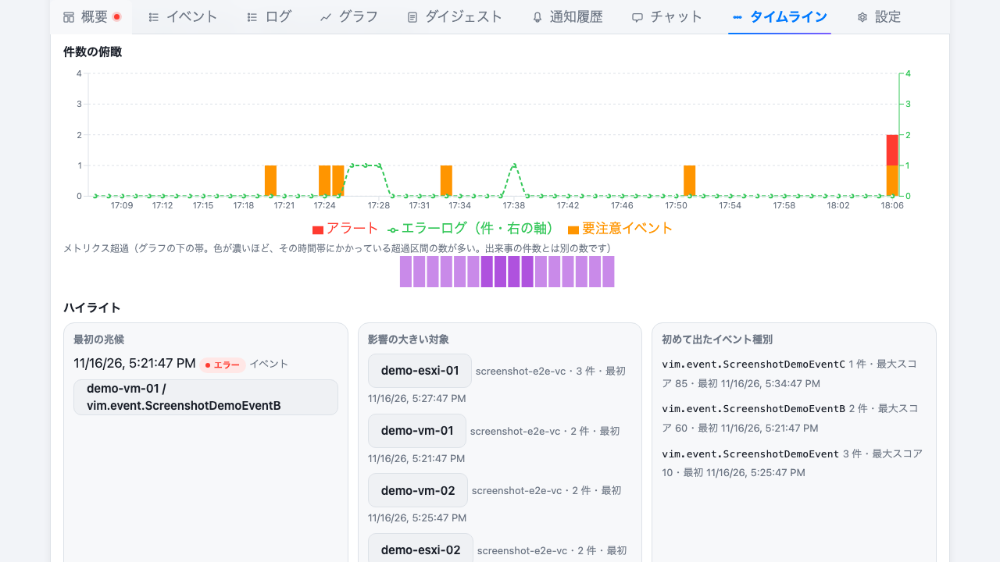

# タイムラインタブの使い方（利用者向け）

<!-- vea-tab-help: timeline -->

vCenter Event Assistant の **タイムライン** タブは、障害の初動で「何が・どこで・どの順に起きたか」を見るための画面である。イベント、通知履歴（アラート）、ホストの CPU・メモリの超過、エラーログを 1 本の時系列にまとめ、個々の出来事まで辿れるようにする。本書は開発者向けではなく、障害対応で画面を使う運用担当者向けに、現行の挙動をまとめたものである。

---

operator 以上は、イベント・アラートの行、構成変更・障害パターンのカード、結果ありのスナップショットから **インシデントに追加** を使えます。[インシデントの使い方](incidents.md)

## 1. この文書の対象と読み方

| 役割 | まず読む節 | 目的 |
|-------------|-----------|------|
| **運用（初動）** — 障害の全体像を掴む | [§2](#2-タイムラインタブの全体像) → [§3](#3-条件の決め方) → [§4](#4-画面の各部の読み方) | 期間と条件を決め、出来事の順序を読む |
| **運用（入口）** — 通知履歴・イベント・概要から来た | [§6](#6-他機能との関係) → [§7](#7-画面別操作) | 「タイムラインで見る」からの操作の流れ |
| **運用（記録）** — 調査の結果を残す | [§5](#5-スナップショット) → [調査資料の出力](#調査資料の出力) | 結果の保存と出力 |

用語の区別:

| 用語 | 意味 |
|------|------|
| **出来事** | 時系列リストの 1 行。イベント・アラート（通知履歴の発火・回復）・メトリクスの超過区間・エラーログのいずれか。 |
| **起点** | 調べたい時刻。「タイムラインで見る」や行の「ここを起点にする」で決まる。起点の前後で読める。 |
| **スナップショット** | 条件と、保存した時点の結果をまとめて残したもの（[§5](#5-スナップショット)）。 |
| **アラート（タイムライン上）** | 通知履歴に記録された発火・回復。[アラート機能の使い方](alerts.md) の通知の記録そのもので、メールの送信とは別の表示である。 |

---

## 2. タイムラインタブの全体像

1. タブを開くと、直近 1 時間を自動で読み込む。「生成」ボタンはない。
2. 期間・vCenter・対象・種別を決める。条件を変えると読み直す。必要なら「詳細設定」でスコアの下限やしきい値を変える。
3. 上の **件数の俯瞰** で、件数が多い時間帯を見る。
4. **ハイライト** で、最初の兆候、影響の大きい対象、初めて出たイベント種別、検知した障害パターン、構成変更を確かめる。対象を管理対象 ID（moid）で絞っているときは、下の **影響範囲** でその時点の関係を、隣の **構成の差分** で観測した設定値の変化を確認できる。
5. **時系列リスト** の行を開き、詳細を読む。そこから「イベントで開く」「ログで開く」「グラフで開く」などで元の画面へ移る。
6. 条件は URL に入るので、そのまま共有できる。下部の **スナップショット** で、今の結果を保存することもできる。

出来事は次の 4 種類である。

| 種別 | 内容 |
|------|------|
| **イベント** | スコアが下限以上のイベントと、別枠で追加する下限未満の構成変更。同じ種別・同じ対象が続くものは 1 行にまとめ、件数を出す。 |
| **アラート** | 通知履歴にある発火・回復。ルール名と状態（発火中・回復済み。古いデータの場合は「データ古い」）を出す。 |
| **メトリクス** | ホストの CPU 使用率・メモリ使用率がしきい値以上だった区間。開始・終了・ピーク値・サンプル数を出す。 |
| **ログ** | 重大度が error 以上のログ。同じホスト・同じ種類が続くものは 1 行にまとめる。 |

---

## 3. 条件の決め方

### 期間と起点

- 期間は **直近 1 時間 / 直近 6 時間 / 直近 24 時間** のどれかを選ぶ。既定は直近 1 時間である。直近の期間は、開くたびに「今から遡った期間」になる。
- 期間の開始と終了を指定して **適用** を押す（または Enter）と、その期間を固定して読み込む。時刻は設定のタイムゾーンで入力する。
- 起点があるときは、**起点の前後 15 分 / 1 時間 / 6 時間** のボタンが出る。起点を決めた時刻を中心に、期間を組み直せる。
- 起点は **起点を解除** で外せる。
- **更新** は、同じ条件で読み直す。

### 絞り込み（常時表示）

| 項目 | 内容 |
|------|------|
| **vCenter** | 「全て」か、登録されている vCenter のどれか。 |
| **対象（ホスト・VM 名）** | 手入力では名前の部分一致で絞る。「moid で一致」と表示されているあいだは、vCenter と対象の ID（moid）で絞っている。 |
| **種別** | イベント・アラート・メトリクス・ログを切り替える。少なくとも 1 つは選んだままになる。 |

「影響の大きい対象」または行の「この対象で絞る」を押すと、対象の欄に名前が入る。vCenter と moid が分かる対象は、その両方の完全一致で絞る。同じ vCenter の moid を持たない古いイベントやログは、名前の大文字と小文字を区別せず、完全一致で拾う。選んだ対象の vCenter または moid が分からないときは、名前の部分一致で絞る。

「moid で一致」に、絞り込みに使う ID が出る。横の「指定を外す」を押すと、名前と moid が外れる。対象の欄を編集すると印が消え、入力が止まったあとに名前の部分一致に切り替わる。元の名前に書き戻したときも同じである。別の vCenter に切り替えると moid の指定が外れ、残った名前で新しい vCenter を部分一致で絞る（同じ vCenter を選び直したときは moid の指定が残る）。moid で絞った条件は URL にも入るので、開き直しても同じ条件で調べられる。

### 詳細設定（折りたたみ）

| 項目 | 既定 | 内容 |
|------|------|------|
| **最小スコア** | 1 | このスコア以上のイベントを一覧に出す。構成変更は最小スコアに関係なく表示する。俯瞰グラフの「その他のイベント」には、下限未満のものも含まれる。 |
| **CPU 使用率のしきい値（%）** | 80 | CPU 使用率がこの値以上だった区間を、メトリクスとして出す。 |
| **メモリ使用率のしきい値（%）** | 85 | メモリ使用率がこの値以上だった区間を、メトリクスとして出す。 |

ディスクとネットワークは、メトリクスの対象外である。値が KB/s で、% のしきい値を当てられないためである。

---

## 4. 画面の各部の読み方

### 件数の俯瞰

- 時間帯ごとの件数を、棒グラフで表す。棒は種別ごとに積み上がり、「その他のイベント」「要注意イベント」「アラート」の順に並ぶ。
- **エラーログ** の件数は破線で、右の軸に出る。
- グラフの下の **帯** は、メトリクスの超過区間の多さを表す。色が濃いほど、その時間帯にかかる超過区間が多い。帯は件数の棒とは足さない。区間は複数の時間帯にまたがるためである。
- 起点がある場合は、起点の位置に縦線を引く。
- 棒をクリックするとその時間帯、ドラッグすると選んだ範囲に期間を絞る。キーボードでも操作できる（左右の矢印で時間帯を選び、Shift と矢印で範囲を広げ、Enter で絞る。Escape で選択をやめる）。
- 絞り込んだあとは、**絞り込み前の期間に戻す** で元の期間に戻せる。

### ハイライト

| 見出し | 内容 |
|--------|------|
| **最初の兆候** | 期間内で最初に起きた重要な出来事。 |
| **影響の大きい対象** | 出来事の多い対象。クリックするとその対象で絞る。 |
| **初めて出たイベント種別** | 直前の同じ長さの期間には無く、今回初めて出たイベント種別。 |
| **検知した障害パターン** | 同じ vCenter の同じ対象で起きたイベントの並びから見つけた障害パターン。 |
| **初めて警告以上で出たログの型** | この環境で初めて警告以上になったログの型。 |
| **構成変更** | 期間の始まりから起点（起点が無ければ期間の終わり）までに検出した変更と、種類ごとの件数。 |

最初の兆候が一覧の上限で省かれている場合は、その旨を表示する。

「影響の大きい対象」は、同じ vCenter の中で対象の ID（moid）ごとに数える。同名でも ID が違えば別々に数え、名前を変えた対象は 1 つにまとめて最新の名前を出す。名前が分からない対象は ID で表示する。イベントはまとめる前の件数、ログはまとめたあとの行数で数える。

古いイベントやログなど、対象の ID が無い行は、その応答の行に同じ vCenter・同じ名前の ID 付きの対象が 1 つだけあれば合算する。名前の大文字と小文字は区別しない。候補が無いか 2 つ以上あるときは、名前だけの対象として別に数え、最新の行の表記を出す。候補は期間・vCenter・表示する種別や、件数超過で種別が省かれたかによって変わる。選んだ期間に出来事が無い同名の対象は、候補に入らない。

「影響の大きい対象」の件数と、押した先の一覧が食い違うことがある。

- 名前を変えた対象では、古い名前の moid の無い行も、その名前が集計時の候補にあれば件数に入る。押した先では最新の名前で絞るため、その行は一覧に出ない。
- 同じ名前の moid の対象が 2 つ以上あると、moid の無い行は個々の対象の件数に入らない。どちらの対象を押しても、名前が一致する行は一覧に出る。

### 初めて警告以上で出たログの型

種別に「ログ」を選んでいるとき、表示期間にこの環境で初めて警告以上となった型を表示する。以前から情報レベルで出ていて、今回初めて警告以上になった型も含む。判定には表示期間全体を使う。型の作り方は [ログの型でまとめて調べる](remote-log-collector.md#ログの型でまとめて調べる) を参照する。

各型について、ログ種別、ホスト、vCenter、期間内の警告以上の行数、最初の時刻、最大の重大度を表示する。表示は最大 10 件である。「ここを起点にする」を押すと最初の時刻を起点にできる。「ログで開く」を押すと、表示期間・型・vCenter で絞ったログ一覧が開く。タイムラインの対象（ホスト）の絞り込みは引き継がないため、同じ型であれば別のホストの行や情報レベルの行も表示される。

カードは、種別に「ログ」を選んでいる場合か、保存結果にログの判定結果や埋め戻し中の情報がある場合に表示する。この機能の追加前に保存した結果では、ログが対象であれば「判定していません」と表示する。台帳を埋め戻している間も判定を保留する。慣らしの期間のため判定から外れた出どころは最大 20 件を表示し、残りは「ほかに N 件」と知らせる。期間の開始がログの保持期間より前の場合は、該当するログが既に削除され、型が表示されないことがある。

### 検知した障害パターン

検知ごとにパターンの名前・レベル・対象・vCenter・最初と最後の時刻・判定に使ったイベントの件数を出す。対象の名前が分からないときは、ID（moid）を出す。「説明」を開くと、何が起きたかと確認する箇所を読める。「ここを起点にする」を押すと、期間の設定を変えずに、検知の最初の時刻を起点にする。条件バーで起点の前後 15 分・1 時間・6 時間から期間を選べる。期間より前から始まった検知は、期間を選び直すと最初のイベントから調べられる。

PDL のカードには、ホスト情報の下にデバイス ID を表示する。「デバイスを特定できません」と出た場合は、保存されたイベント本文から ID を一つに絞れなかったことを示す。同じホストで同時刻に検知したカードは、併記したイベント ID で区別できる。

検知は最大 20 件を表示し、それを超える分は「ほかに N 件」と知らせる。検知が無いときは欄を出さない。判定に使う行が上限を超えたパターンがあれば、検知が無いときもその旨を表示する。上限はイベントと対象の子表を結合した結果で 1 パターンにつき 10,000 行である。「件数が多すぎるため判定しなかったパターンがあります」と出たら、期間を短くするか、vCenter を絞る。

判定は、種別に「イベント」を選んでいるときに行う。選んだ期間に判定に使ったイベントが 1 件でもあれば、期間の前から始まった並びも検知の対象になる。最小スコアは時系列リストに適用し、パターンの判定には適用しない。対象を保存する子表（`event_entities`）に行の無い古いイベントは、判定に入らない。

対象名（`entity`）の部分一致で絞ると、名前が分からず moid だけを表示する検知は外れる。moid で絞ると、検知は子表のうちパターンが使うどの役割でも一致する。時系列リストではイベントの主な対象の moid だけが一致の対象になる。

検知に「この対象で絞る」が無いのは、この違いにより検知に使ったイベントが一覧に出ないことがあるためである。たとえば、HA によるフェイルオーバーはクラスタで判定するが、イベントの主な対象は障害ホストや VM である。

| 組み込みのパターン | レベル | 判定の規則 |
|--------------------|--------|------------|
| ホストの切断の繰り返し | エラー | 同じホストが 60 分以内に 3 回以上切断した。 |
| ホストの切断後の再接続の失敗 | エラー | ホストの切断後、30 分以内に同じホストの再接続が失敗した。 |
| APD のタイムアウト | クリティカル | APD（All Paths Down）の開始後、10 分以内に同じホストで APD のタイムアウトが起きた。 |
| APD の繰り返し | エラー | 同じホストで 60 分以内に APD が 2 回以上始まった。120 秒以内に続いた開始は 1 回と数える。 |
| NIC のリンクの不安定 | 警告 | 同じホストで 30 分以内に NIC のリンクダウンが 3 回以上起きた。60 秒以内に続いたリンクダウンは 1 回と数える。 |
| HA によるフェイルオーバー | クリティカル | HA がホストの障害を検知してから 30 分以内に、同じクラスタで HA による VM の再起動が起きた。 |
| vMotion の連続失敗 | 警告 | 同じホストで 60 分以内に vMotion の失敗が 3 回以上起きた。 |
| デバイスの恒久的な喪失（PDL） | クリティカル | ホストがストレージデバイス（LUN）の恒久的な喪失を報告した。同じホストとデバイスで最初のイベントから 300 秒以内に続いたイベントは 1 件の検知にまとめる。 |

PDL のデバイス ID は保存したイベント本文から読み取る。特定できなかったイベントは 1 件ずつ検知する。対象名で絞るときはホスト名を使う。デバイス ID は調査資料と通知本文に載る。タイムラインのアラート行、通知履歴、インシデントに追加した検知の関連情報ではホスト単位で扱い、インシデントにはイベント本文が残る。イベントにホストの種別が記録されていない場合、対応手順の候補には接続先が添わないことがある。

繰り返しの判定では、条件を満たした時間の窓が重なる場合、1 件の検知にまとめる。表示する期間は判定の時間幅より長くなることがある。表示する件数には、判定で 1 回にまとめたイベントもすべて含む。

### 構成変更

種別で「イベント」を選ぶと、最小スコアに関係なく、次のイベントと成功したタスクを構成変更として検出する。

| 種類 | 主な例 |
|------|--------|
| VM の構成変更 | VM の再構成 |
| メンテナンスモードに入った | ホスト・データストアのメンテナンスモードの開始 |
| メンテナンスモードを出た | ホスト・データストアのメンテナンスモードの終了 |
| クラスタの設定の変更 | DRS・HA・アドミッションコントロールの設定 |
| ネットワークの設定の変更 | 仮想スイッチ・ポートグループ・DNS・ルーティングの設定 |
| ストレージの設定の変更 | ストレージ I/O コントロール、マルチパス、VMFS のマウント・アンマウント |
| リソースの割り当ての変更 | リソースプール・vApp の設定 |
| ホストの設定の変更 | ホストプロファイル、詳細設定、時刻、SNMP、サービスの設定 |
| ホストのアクセスの設定の変更 | SSH・シェル・DCUI・ロックダウンモード・ファイアウォールの設定 |
| 権限とロールの変更 | 権限・ロールの追加、変更、削除 |
| インベントリの変更 | ホストの追加・削除・移動、管理対象の名前の変更 |
| アップグレード | VMware Tools、VM の仮想ハードウェア、分散スイッチ、Update Manager によるホストのアップグレード |

時系列リストには、表示期間全体の該当行に「構成変更」の印が付く。最小スコアに満たない行は、期間の始まりから、起点と期間の終わりのうち早いほうまでを対象とする。この追加枠には、起点または期間の終わりに近い行から最大 50 件（一覧の上限が 50 件未満ならその上限、つまり `min(50, item_limit)`）を表示する。「◆ 起点に最も近い」は一覧のすべての行から選ぶため、構成変更の行に付くことがある。

「構成変更」カードは、期間の始まりから、起点と期間の終わりのうち早いほうまでを集計する。起点が期間内にあれば、その時刻の変更も含める。変更の種類と vCenter が同じ行のうち、組み込みコレクタで同じ一連の処理を表すイベントとタスクを優先して 1 件にまとめる。それ以外は、同じ対象への変更が 5 分以内に続いた場合にまとめる。対象が無い行は、同じ利用者による変更が 5 分以内に続いた場合にまとめる。

カードの上部に種類ごとの件数を出し、下に新しい順で最大 20 件を表示する。各項目には対象・vCenter・利用者・時刻・まとめた行の件数が出る。「ここを起点にする」は最後の時刻を起点にし、「この対象で絞る」は対象の ID（moid）または名前で絞る。

一覧で複数のイベントを 1 行にまとめた場合、その行には先頭のイベント ID が残る。カードが持つイベント ID（`event_ids`）は、時刻順に最初の 20 件までである。その ID を先頭から確認し、一覧にあるものが見つかった場合だけ「一覧の行へ移動」が出る。押すと最初に見つかった行を開ける。

件数の上限で古い変更を省いた場合は「古い構成変更は省きました」と出る。判定結果が 0 件なら「この期間に構成変更はありません」、起点がある場合は「起点までに構成変更はありません」と出る。

「構成変更」カードの各項目には、対象と時刻が重なる観測結果があれば、構成の差分も表示する。カードに添った差分に複数の対象が含まれる場合は、差分の行に対象名を添える。名前が無いときは moid を表示する。「ほか N 件」と出た場合は、対象を moid で絞って「構成の差分」の欄を確認する。観測の幅に複数の操作が含まれる場合、別の操作による差分が添わることもある。

SSH・シェル・DCUI の有効化を示す `esx.audit.*` は、ホストの設定によっては起動時にも記録される。障害からの再起動後に構成変更として表示されることがあるため、操作の有無は周辺のイベントと合わせて確認する。[構成変更の検出の仕組み](../features/config-change-detection.md)

### 影響範囲

イベントやハイライトの「この対象で絞る」などで、vCenter と管理対象 ID（moid）が指定されていると、ハイライトの下に **影響範囲** が出る。対象名の部分一致で絞っている場合は対象を一意に決められないため、この欄は出ない。

- **時点** の既定は、起点、最初の兆候、期間の始まりの順に決まる。タイムラインが件数超過などで 422 を返した場合は、起点があれば起点、なければ期間の始まりを使う。それ以外の失敗では影響範囲を出せない旨を表示する。「期間の始まり」「期間の終わり」に切り替えると、それぞれの時点の関係を確認できる。
- クラスタ、ホスト、VM、データストア、ネットワークなどの関係を、件数と名前で表示する。長い一覧は見出しを開く。「ほか N 件」は表示上限を超えた件数で、「現在は見えない」は最後の観測で見えなくなった対象を表す。各項目の名前を押すと、その対象のタイムラインに切り替える。
- **期間中の変化** を開くと、期間内に観測した関係の開始・終了と、その時刻を確認できる。同じ種類の関係の開始と終了が同じ観測時刻にそろうと、たとえば「ホスト: esx-02 → esx-03」のように 1 行で出る。対応する変化がない項目は、開始・終了を個別に表示する。

関係は収集用アカウントから見えた範囲で、観測時刻は実際の変化から最大で収集の間隔だけずれることがある。収集が止まっていた場合は前後の観測時刻を目安にする。保持期間（既定 7 日）を過ぎた関係は、保存したスナップショットから開いた場合も「この時点の関係は記録されていません」と出る。収集が一度も成功していない場合は「まだ関係を収集していません」と出る。最後の収集結果や失敗の内容は **設定 → vCenter** で確認できる。[関係の収集状態](summary.md#関係の収集状態)

### 構成の差分

対象を vCenter と管理対象 ID（moid）で絞ると、**影響範囲** の隣に **構成の差分** が出る。タイムラインの期間と観測の幅が重なる差分を新しい順に表示する。イベントに残らなかった変更も、観測した設定値に違いがあればここで見られる。

- 種類・要素・項目と、古い値から新しい値への変化を確認できる。「追加」「削除」「入れ替わり」の行を開くと、要素の項目が見られる。
- 変化は、前の値を最後に確かめた時刻から、新しい値を観測した時刻までの間に起きた。収集の失敗や読み残しが続くと、この幅は広がる。
- 新しい方から最大 200 件を表示する。装置の入れ替わりが上限にかかるときは対の行も表示する。一部だけ表示している場合は、総数と実際の表示件数を添える。残りを確認するには期間を短くする。
- 0 件の表示は、期間内の観測で差分が記録されていないことを示す。記録の開始前や保持期間外（既定 30 日）を含む場合、0 件の表示に記録の開始時刻を添える。
- 「記録をやり直す前の値」は、vCenter の入れ替えなどで構成の記録を始め直す前に観測した差分を示す。同じ moid が別の対象を指すことがある。
- 構成の読み取りが無効でも、保存されている差分は表示する。収集状況は **設定 → vCenter** で確認できる。[構成の読み取りの状態](summary.md#構成の読み取りの状態)

### 時系列リスト

- 行は、時刻・種別・レベル（色）・対象・タイトル・メッセージの抜粋で並ぶ。並び順は「古い順」「新しい順」を切り替えられる。
- 起点に最も近い行には「◆ 起点に最も近い」と出る。
- 行を開くと、メッセージ全文・対象・スコアや、メトリクスならピーク値・超過区間・しきい値・サンプル数、アラートならルール名と状態を読める。同じ種別・対象がまとめられた行は「まとめた件数」を出す。
- メトリクスの超過が期間の端で続いているときは、始まり・終わりを言い切らない。期間の開始前から続いていれば「期間の開始前から」、期間の終わりを越えて続いていれば「期間の終わりでも継続中」と書き、長さは「継続 ○ 分以上」とする。
- 行には、そのあとの操作を置いている（[§7](#7-画面別操作)）。

### 一覧に残す行と注記

通常の一覧枠は、既定で 500 行である。最小スコアに満たない構成変更は、別枠で最大 50 件加える。追加枠の上限は、一覧の上限が 50 件未満の場合はその件数になる。

- 起点が無いときは、重要度の高い順に残す。
- ほかの種別（アラート・イベント・メトリクス）の行のために、一覧の 4 分の 1 までを空けておく。ほかの種別の行がそれより少なければ、残りはログで埋める。
- 起点があるときは、起点に近い行を残す。
- 件数が多すぎる種別は一覧から省き、その旨を表示する。省いた種別は、次のように書く。
  - ログ: 「ログは件数が多すぎるため、一覧から省いています（件数は上のグラフに出ています）。」
  - メトリクス: 「メトリクスの超過区間は件数が多すぎるため、一覧から省いています（グラフにも出ていません）。しきい値を上げるか、期間を短くするか、対象を絞ってください。」

省いたあとも、期間を短くするか、対象を絞れば一覧に出る。通常の一覧枠を超えたときは「○ 件中 ○ 件を表示しています」と出る。構成変更の追加枠を超えたときは「構成変更の行は、起点に近い N 件だけを一覧に出しています」と別に表示する。起点が無い場合は「期間の終わりに近い N 件」と出る。

---

## 5. スナップショット

画面の下部にある **スナップショット** は、既定で閉じている。開くと次の操作ができる。

- **保存** — 運用メモ（必須）を入れて **スナップショットを保存** を押すと、表示中の条件と、保存時点の結果を残す。結果はサーバーが集計し直したものである。保存は **operator** 以上の権限が必要である。
- **一覧** — 保存したものが一覧に並ぶ。結果を持つものには「結果あり」と出る。項目を押すと、その内容を開く。**グラフで開く** で、グラフタブへ移ることもある。

保存済みの結果を開くと、「保存時点の内容を表示しています。」と出る。このあいだは、「更新」が使えず、新しく保存もできない。**現在のデータで再集計** を押すと、通常の表示に戻る。

障害パターンの判定（PR #361）が入る前に保存したスナップショットの結果には、「検知した障害パターン」は出ない。構成変更の判定が入る前に保存した結果では、「構成変更」カードに「判定していません」と出る。カードには保存時に添わった差分が表示される。保存した条件が対象を moid で絞っている場合、「構成の差分」の欄は、その対象と期間について現在残っている差分を取得する。

保存時点の結果は、元のイベント・ログ・メトリクスの保持期間（既定 7 日）を過ぎても、スナップショットの保持期間（既定 90 日。環境変数 `INCIDENT_TIMELINE_SNAPSHOT_RETENTION_DAYS`）のあいだは見られる。ただし、元データは残っていないので、行の「イベントで開く」「ログで開く」「グラフで開く」の先は空になることがある。「この対象で絞る」「ここを起点にする」は、現在のデータでの再集計になる。

保存した結果には、イベントやログのメッセージ本文が含まれる。共有する前に、その点を確かめる。

管理者は、保存した結果だけを早く消すよう設定できる（環境変数 `INCIDENT_TIMELINE_SNAPSHOT_RESULT_RETENTION_DAYS`。既定の 0 は、スナップショットと同じ期間残す）。その日数を過ぎたスナップショットは、運用メモと条件だけが残り、「結果あり」の表示が消える。開くと、保存した条件で現在のデータを再集計する。

アラート発火時に自動で作られるスナップショットは、条件だけを持つ。開くと、そのときの条件で再集計する。

### 調査資料の出力

タイムラインの件数表示の近くにある **調査資料を出力** で、**Markdown** または **ZIP** を選ぶ。viewer 以上が利用できる。報告書と CSV の時刻、ファイル名の時刻には、画面の表示タイムゾーンを使う。

- **今の表示** では、表示に使った条件で現在のデータを再集計する。画面の読み込みから出力までにデータが増えたり、保持期間を過ぎたりすると、画面と件数が異なることがある。
- **保存した結果** を表示中は、保存時点の結果と運用メモを使う。スナップショット一覧の各行からも出力できる。結果が保存されていない行は、開いて再集計してから「今の表示」を出力する。元データの保持期間（既定 7 日）を過ぎている場合、再集計の結果は空か一部になる。

**Markdown** は、出典、条件、概要、ハイライト、注目すべき出来事（保存した結果では運用メモも）をまとめた報告書（`.md`）である。**ZIP** には次のファイルが入る。

- `report.md` は Markdown の報告書。
- `items.csv` はタイムラインの結果に含まれる出来事（打ち切った後の全行）。
- `overview.csv` は俯瞰グラフの時間区分ごとの件数。
- `result.json` はタイムラインの結果。
- `conditions.json` は集計条件と出典。保存した結果では、スナップショットの ID、保存日時、運用メモも入る。

報告書の「注目すべき出来事」は最大 100 件である。全件を確認するには、ZIP の `items.csv` を開く。集計結果の打ち切りがある場合は、報告書に総数と表示件数が記載され、CSV には打ち切り後の結果に含まれる行が入る。件数の上限で省かれた種別も、報告書の概要で確認できる。

#### 外部に渡すときの確認

資料には vCenter・ホスト・VM の名前、管理対象 ID（moid）、イベントやログの内容、保存時の運用メモなどが入る。外部に渡す前に、共有してよい内容かを確かめる。ダウンロードしたファイルや共有先のコピーは、元データやスナップショットの保持期間を過ぎても残る。

構成変更を行った利用者の名前は、報告書、ZIP の `result.json`、手動で保存したスナップショットの結果に入る。viewer も保存した結果を読めるため、外部への共有前に利用者名も確認する。元のイベントの保持期間（既定 7 日）が過ぎても、スナップショットの結果の保持期間（既定 90 日）のあいだは、利用者名が残る。

観測した構成の差分には、ポートグループ名、ネットワークの識別子、MAC アドレス、ディスクの UUID などが含まれることがある。カードに添わった差分は、報告書、ZIP の `result.json`、保存したスナップショットの結果にも入る。外部に渡す前に、変更前後の値も確認する。

Markdown の貼り付け先は GitHub と GitLab を想定している。GitHub のコメントなどには長さの上限がある（目安は数万文字）。GitLab のコメントは 1,000,000 文字まで。上限に収まらない場合はファイルを添付する。Jira のウィキ記法や Redmine の Textile を使う場合は、ファイルを添付するか、本文をコードブロックに入れて貼る。[GitLab Notes API](https://docs.gitlab.com/api/notes/)。

---

## 6. 他機能との関係

| 機能 | タイムラインとの関係 |
|------|----------------------|
| **通知履歴** | 行の「タイムラインで見る」で、発火・回復の時刻の前後 30 分を、同じ vCenter・対象で開く。 |
| **イベント** | 行の「タイムラインで見る」で、発生時刻の前後 30 分を、同じ vCenter・対象で開く。 |
| **概要** | 要注意イベント、高 CPU・高メモリのホストの行から、同じように開く。 |
| **グラフ** | 行の「グラフで開く」で、期間・vCenter・起点の目印を渡して開く。タイムラインのスナップショットからも開ける。 |
| **チャット** | 「この範囲をチャットで分析」（operator 以上）で、表示中の期間と vCenter をチャットタブに渡す。期間が 90 日を超えるときは押せない。対象・種別・起点・最小スコア・しきい値は渡らず、メッセージも自動では送らない。チャットは保存済みの結果ではなく、現在のデータで集計する。 |
| **アラート（メール）** | タイムラインはメールを送らない。メールは [アラート機能の使い方](alerts.md) のアラートルールによる通知の役目である（[§8](#8-よくある質問と切り分け) を参照）。 |

通知履歴・イベント・概要の「タイムラインで見る」は、vCenter と対象の moid が分かるときは両方を渡す。名前が分からない対象でも、vCenter と moid で絞って開ける。対象名だけが分かるときは名前の部分一致で開く。

---

## 7. 画面別操作

### タイムライン（メインタブ）

通知履歴から調べる場合の例を示す。

1. **通知履歴** の行で「タイムラインで見る」を押す。発火時刻の前後 30 分が、同じ vCenter・対象で開く。
2. 出来事の多い対象が気になるときは、その行を開いて **この対象で絞る** を押す。
3. 順序を確かめたい行を開いて **ここを起点にする** を押す。起点の前後 15 分・1 時間・6 時間から期間を選べる。
4. 元のイベントを見るときは **イベントで開く**、ログを見るときは **ログで開く** を押す。行の時刻の前後の範囲で、それぞれの画面が開く。
5. ホストの負荷を見るときは **グラフで開く** を押す（vCenter のある行に出る）。

行の操作は、次のとおりである。

| ボタン | 動き |
|--------|------|
| **この対象で絞る** | 対象の欄にその行の名前を入れ、vCenter と moid が分かれば完全一致で絞る。それ以外は名前の部分一致で絞る。 |
| **ここを起点にする** | その行の時刻を起点にする。起点の前後の期間を選べる。 |
| **イベントで開く** | イベント画面を、その時刻の前後で開く。 |
| **ログで開く** | ログ画面を、その時刻の前後で開く。 |
| **グラフで開く** | グラフ画面を、期間・vCenter・起点の目印を渡して開く。 |

条件の変更は、すべて URL に入る。URL を別のタブで開くと、同じ条件で表示される。時刻は **設定 → 一般** のタイムゾーンで表示する。

---

## 8. よくある質問と切り分け

### タイムラインにアラートの行があるのに、メールが来ない

- 行は、通知履歴に記録された発火・回復である。メールが送られたかどうかは、通知履歴の **結果** 列で確かめる（配送待ち・再送待ち・成功・打ち切り・失敗・未送信）。詳しくは [アラート機能の使い方](alerts.md) §6 と §8 を参照する。
- 結果が「成功」なのに届かない場合は、受信側の迷惑メールや転送設定を確かめる（[アラート機能の使い方](alerts.md) §8 の「通知履歴は「成功」だがメールが届かない」と同じ扱い）。
- 結果が「失敗」や「未送信」なら、SMTP や宛先の設定を管理者に確かめる。

### メトリクスやログが出ない

- 種別の欄で、メトリクスまたはログにチェックが入っているか確かめる。
- メトリクスは、CPU・メモリの使用率がしきい値以上だった区間だけを出す（既定は 80% と 85%）。しきい値を下げるか、期間を広げる。ディスクとネットワークは対象外である。
- ログは、重大度が error 以上のものだけを出す。警告や情報は出ない。
- 期間の端で続いている超過は、行に「期間の開始前から」「期間の終わりでも継続中」と出て、長さは「継続 ○ 分以上」になる。
- 一覧から省かれている場合は、「○○は件数が多すぎるため、一覧から省いています」と出る。期間を短くするか、対象を絞る。ログの件数は、グラフの破線で見られる。メトリクスの超過は、省かれたときはグラフの帯にも出ない。
- メトリクスは、期間内でしきい値以上だったサンプルが多すぎるとき（既定で 4 万件を超えるとき）にも省かれる。多くのホストが長いあいだしきい値以上になっている場合に起きる。「詳細設定」でしきい値を上げるか、期間を短くするか、対象を絞る。上限は、管理者が環境変数 `TIMELINE_METRIC_BREACH_SAMPLE_LIMIT` で変えられる。
- moid で絞っているときは、同じ vCenter で対象名とホスト名が完全一致するログだけが出る。FQDN・短い名前・IP の表記違いは拾えないため、名前の部分一致で絞るときより範囲が狭くなる。

### 対象で絞ったときのイベントの見え方

- moid を持たない古いイベントは名前の完全一致で拾うため、同じ vCenter にある同名の別の対象のイベントが入り得る。保持期間（既定 7 日）を過ぎると、古いイベントは消える。
- 名前の分からない対象を他のタブのリンクから開いたときや、URL を手で書いて名前を指定せずに moid で絞ったときは、直前の期間にある moid の無い行は拾われない。このため、「初めて出たイベント種別」が実際より多く出ることがある。

### 「省いています」と表示される

- 件数が多すぎる種別を一覧から外した表示である。[§4](#4-画面の各部の読み方) のとおり、期間を短くするか、対象を絞る。
- 全体の件数は、グラフで確かめられる。

### スナップショットを開いたら空だった、または一部が空だった

- 元のイベント・ログ・メトリクスが保持期間（既定 7 日）を過ぎている可能性がある。保存時点の俯瞰と一覧は残るが、行の「イベントで開く」「ログで開く」「グラフで開く」の先は空になることがある。
- 結果を持たないスナップショット（アラート発火時の自動保存など）は、開くと現在のデータで再集計する。元データが保持期間を過ぎていれば、そこに残っている内容だけが表示される。
- 保存時点の内容ではなく最新の内容で見たいときは **現在のデータで再集計** を押す。

### 件数が「○ 件中 ○ 件を表示しています」と出る

- 一覧の上限（既定 500 行）を超えている。期間を短くするか、種別や対象で絞る。最小スコアを上げると通常のイベントを絞れる。構成変更は最小スコアに関係なく表示する。

### スナップショットを保存できない

- 運用メモを入れているか確かめる（必須である）。
- 保存済みの結果を表示しているときは保存できない。**現在のデータで再集計** を押してから保存する。
- 権限が viewer の場合は、保存できない（operator 以上が必要）。

### チャットタブに渡した期間や対象が違う

- 渡るのは、表示中の期間（保存済みの結果なら保存した期間）と vCenter だけである。対象・種別・起点・最小スコア・しきい値は渡らない。チャットには、引き継いだことと、絞り込みが渡らないことの注記が出る。
- チャットは現在のデータで集計する。保存済みのスナップショットから押した場合、元のデータが保持期間を過ぎていると、チャットの内容は少ないか空になる。
- 期間が 90 日を超えるとボタンは押せない。期間を縮める。

---

## 9. 関連ドキュメント

| 読者 | ドキュメント |
|------|-------------|
| **利用者（本書）** | 本ファイル |
| **アラート（通知の記録とメール）** | [alerts.md](alerts.md) |
| **イベントタブ** | [events.md](events.md) |
| **グラフタブ** | [graph.md](graph.md) |
| **概要タブ** | [summary.md](summary.md) |
| **チャット** | [chat.md](chat.md) |
| **要注目スコア** | [score-rules.md](score-rules.md) |
| **サーバー管理者（保持期間・上限）** | [backend-operations.md](../operations/backend-operations.md) |
| **画面一覧** | [frontend.md](../development/frontend.md) |

---

## 付録: アプリ内ヘルプとの関係

「使い方を表示」の概要説明は要約である。画面の各部の読み方・操作・スナップショットの扱いは **本ガイド** を正本とする。
